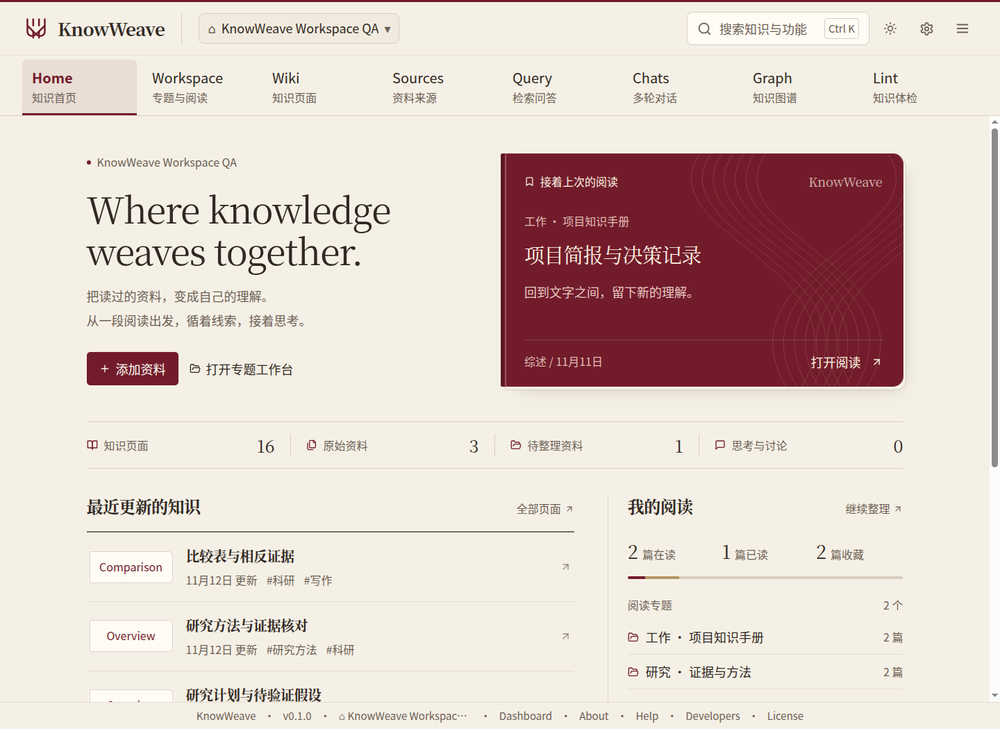
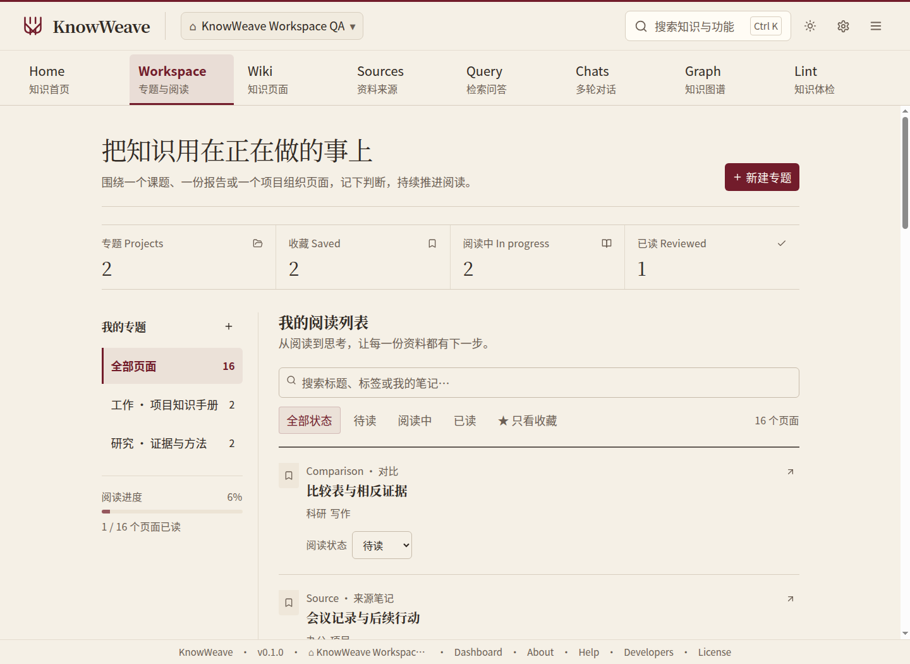
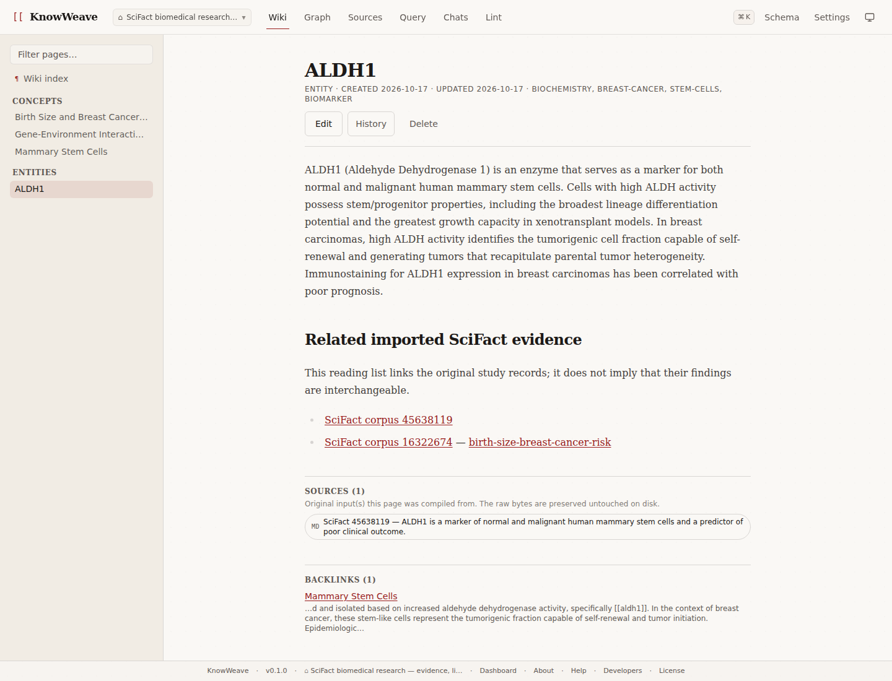
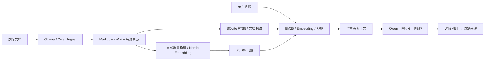

# KnowWeave

**面向科研与知识型工作的本地知识工作台：整理资料、专题阅读、带着证据思考。**

KnowWeave 将文档交给本地 Qwen 整理为 Markdown Wiki，按课题或项目组织页面，记录收藏、阅读进度与个人笔记。支持 BM25、Embedding 和 Hybrid 检索，回答中的 Wiki 引用可继续跳到原始来源；阅读与问答成果可导出复用。

这是基于 MIT 项目 [LLM Wiki](https://github.com/ddsyasas/llm-wiki) 的二次开发作品。本项目重点实现本地 Qwen/Ollama 适配、向量索引维护、混合检索、引用约束、可复现评测，以及专题阅读工作流与产品界面；继承能力和贡献边界见 [NOTICE](NOTICE.md)，原 [LICENSE](LICENSE) 保留。

[本次产品升级](docs/PRODUCT_UPGRADE.md) · [模型与检索验收](docs/ROUND_03_ACCEPTANCE.md) · [架构](architecture.md) · [求职展示与面试提纲](docs/CAREER_PRESENTATION.md) · [独立审阅指南](docs/GPT_REVIEW_GUIDE.md)

## 看一次实际使用

知识首页采用深红与暖纸色的「研究札记」布局：优先呈现正在阅读的真实页面，没有在读时回到收藏或最近页面；交织线条呼应知识之间的连接。近期更新、专题进度与待整理资料仍来自当前知识库，可直接继续上次的工作。首页标题为“Where knowledge weaves together.”，近期页面类型使用英文标签。整站普通文字与操作采用18px、长文阅读20px、日期和标签16px；桌面导航以20px栏目名搭配16px中文说明，窄屏使用「切换栏目」展开入口，保留阅读字号并重新排版。



专题工作台用书签式专题选择和连续阅读列表，围绕研究或项目收集页面、管理阅读状态并留下自己的判断。Wiki 馆藏采用索引行布局，按标题、摘要、类型和标签查找知识。



以上为新版真实浏览器截图，内容由独立的人工演示样例生成，不代表模型生成的研究成果。另见 [窄屏深色阅读页](docs/images/workspace-reading-mobile.png)；可复现的样例命令见下文。

查询页面：选择检索模式，查看索引状态、回答和引用。


Wiki 页面：查看整理后的知识，并沿 Sources 返回原始文献。



截图来自本地应用的真实浏览器操作；另见 [原文追溯截图](docs/images/round03-source.png)。采集范围和验证记录见 [Round 03 验收](docs/ROUND_03_ACCEPTANCE.md)，演示只使用公开 SciFact 样本。

## 主要功能与实现范围

| 能力 | 当前行为 |
| --- | --- |
| 专题与阅读 | 一个页面可加入多个课题/项目；收藏、待读/阅读中/已读、个人笔记按 Wiki 持久化 |
| 知识馆藏 | 搜索标题/标签/目录摘要，组合类型/标签筛选与排序；可直接写笔记，阅读页有目录和 Markdown 导出 |
| 工作首页 | 真实近期更新、阅读进度、继续阅读和待处理来源入口；桌面/窄屏、深浅色界面 |
| 文档 → Wiki | Qwen 生成或更新 Markdown 页面；同名原文独立保存，失败来源可重试，保留页面来源关系 |
| 三路检索 | Query 可选 BM25、Embedding、Hybrid（RRF）；默认 BM25，无需 Embedding 模型 |
| 可维护向量索引 | 各 Wiki 独立存储；内容变化使旧向量失效，显式增量刷新，支持全量重建 |
| 回答与证据 | 实际页面正文进入模型上下文；引用须来自供给正文，支持 Wiki → 原始来源回溯 |
| 知识复用与备份 | 问题/回答/引用一起复制或导出；Wiki ZIP 包含文档与 SQLite 一致快照，保存专题、笔记、来源关系 |
| 可复现评测 | SciFact 官方原始 corpus 的三路检索对比，与小型 Wiki 问答演示分开记录 |

三模式目前用于独立 Query；Ingest 和 Chat 的候选检索仍用 BM25。继承的文本导入、Wiki 浏览与更新构成本轮演示主路径，PDF/OCR 和云端模型不属于当前已验证能力。

## 架构与技术栈



- **应用**：TypeScript、Next.js 14 App Router、React 18；Node.js 22、pnpm 10.12.1。
- **存储与检索**：Markdown、SQLite FTS5/BM25、Float32 向量精确余弦扫描、等权 RRF。
- **本地模型**：Ollama `qwen3.8:27b` 负责整理和回答；`nomic-embed-text:v1.5` 负责向量。
- **工程验证**：Vitest、Python 标准库验收脚本、复用产品检索核心的 TypeScript benchmark。

完整调用链、接口、磁盘格式和维护约定统一见 [architecture.md](architecture.md)。

## 最简启动

需要 Node.js 22、pnpm 10.12.1、Python 3.10+，以及运行中的 [Ollama](https://ollama.com/download)。本项目使用官方提供的 [Qwen3.8 27B tag](https://ollama.com/library/qwen3.8:27b)。若本机使用其他 tag，设置 `OLLAMA_MODEL` 为 `ollama list` 中的准确名称；`pnpm run doctor` 会核验 Ollama 服务与生成模型 tag，不检查 Nomic，也不会下载模型。

在仓库根目录执行：

```bash
pnpm install --frozen-lockfile
ollama pull qwen3.8:27b
ollama pull nomic-embed-text:v1.5
pnpm run doctor
pnpm setup:local
pnpm dev
```

已有模型无需再次下载。同名 tag 可随模型注册表更新；复现实验时应核对验收报告中的模型 digest。当前记录来自既有开发环境，未验证整台干净机器从零安装。

打开 <http://127.0.0.1:3000>，依次进入 **Sources → 导入并整理 → Wiki → Query**。界面保留英文栏目与技术术语，操作步骤和说明以中文呈现。首次使用 Embedding/Hybrid，先在 Query 点击 **构建 / 刷新向量索引**。新增或编辑页面后再次刷新；失败时根据提示处理，或手动选择 BM25。

日常使用可从 **Workspace → 新建专题** 开始，例如「课题文献综述」或「项目知识手册」。把 Wiki 页面加入专题，在阅读页收藏、标记阅读中，并展开 **专题与笔记** 保存自己的判断。个人笔记不会改写正文或进入模型证据；已读仅表示阅读进度。**Wiki → 写一篇笔记** 可以不调用模型直接积累自己的内容。

Wiki 目录可组合搜索、类型、标签与排序；Sources 可按待处理或格式筛选。Query 的三个问题模板只填写输入框，由你决定何时提交；回答生成后可 **复制回答与引用** 或 **导出 Markdown**，导出保留本次实际提交的问题。引用链接仍指向当前 KnowWeave 实例。

**Settings → Wikis → 导出当前 Wiki** 包含 Markdown、原始资料、会话及 SQLite 快照（专题、笔记、来源关系等），不包含设置、历史和回收站。宜在停止编辑/导入时导出，数据库与文档并非统一时点事务。恢复时先停止应用，将 ZIP 解压到目标 Wiki，再重新配置模型。页面软删除后撤销会恢复个人笔记和仍存在的专题关系；直接从磁盘删除页面不经过产品回收流程。

多轮对话进入 **Chats → + 新建会话**，新建后出现输入框；窄屏先点 **会话列表** 展开会话列表。Chat 使用服务器上的本地模型，回复完整生成后显示。更新 Chat 入口代码后，生产服务需要重新 `pnpm build` 并重启 `pnpm start` 才会生效。

网页保留英文栏目与技术术语，步骤、提示和主要操作使用中文。打开 **Graph**，可在 **Map · 2D** 与 **Space · 3D** 间切换，浏览器会记住偏好。Map 使用珠光节点、曲线引用与清晰的标签底板，Space 提供适配深浅色的立体材质、光照和投影标签；悬停或选择节点会突出相邻页面。支持搜索标题或标签、按类型筛选，也可从按实际关联数量排序的页面入口开始探索。

选中节点后可开启「仅看相邻」，查看该页、一跳邻居及它们之间的实际引用；「阅读页面」返回 Wiki。两种视图共用当前选择、筛选和标签开关，隐藏普通标签后仍保留当前选择或悬停提示；Wiki 详情中的 **Graph ↗** 可直接定位该页面。浏览器支持时可全屏查看，3D 的「缓慢环绕」需主动开启，遵循系统减少动态效果设置。连线表示现有页面引用，节点距离不代表语义相似度；浏览器无法使用 WebGL2 时可切回 2D。

**Lint · 知识体检** 提供中文交互，点击「开始检查」可查看失效链接、缺少引用、内容矛盾等问题及建议。检查会记录摘要，不自动改写 Wiki 正文；点击具体修复按钮后才写入页面。这里的「重建页面目录」维护 `index.md`，向量索引仍在 Query 中刷新。

默认 Wiki 在 `.local/wiki`，配置在 `.local/config`，均不入 Git。`setup:local` 会将已有模型槽切回本地 Qwen；启动器监听本机回环地址。原生依赖首次编译可能需要 `make`、`g++`、Python 和 Linux 的 `libsecret-1-dev`。生产运行：

```bash
NEXT_TELEMETRY_DISABLED=1 pnpm build
pnpm start
```

通过 VS Code Remote SSH 打开本仓库根目录时，[工作区配置](.vscode/settings.json)会自动发现并转发服务器上已运行的 `3000`（默认知识库）和 `3001`（演示知识库），并恢复此前的转发。`3000` 新建自动转发时会请求打开本机浏览器，`3001` 静默转发；其他端口不自动转发。默认访问 `http://localhost:3000`，本机端口被占用时以 VS Code「端口 / Ports」面板的本地地址为准。已有转发被恢复时可能不会再次弹出浏览器，仍可使用该地址。第一次应用配置可执行 `Developer: Reload Window`，使用期间保持 Remote SSH 连接。

此配置以服务器应用已经运行为前提，不负责启动应用；服务器重启或应用停止后，在远程终端执行 `pnpm start`（需已有生产构建），本机浏览器即可继续通过转发访问。服务器不需要安装浏览器。也可在浏览器所在电脑运行 `ssh -N -L 13000:127.0.0.1:3000 <账号>@<服务器>`，再访问 `http://127.0.0.1:13000`。演示使用端口 `3001` 时相应调整转发端口。

## 不调用模型的产品演示样例

以下创建 16 页人工演示资料、两个专题和阅读记录，供界面演示与浏览器验收；不下载模型、不把内容计作科研成果。要求目标目录为空，重复运行请换新目录。

```bash
pnpm demo:workspace:prepare
KNOWWAEVE_WIKI_PATH="$PWD/.local/workspace-demo/fixture-wiki" \
KNOWWAEVE_CONFIG_DIR="$PWD/.local/workspace-demo/fixture-config" \
pnpm --filter @llm-wiki/web dev --hostname 127.0.0.1 --port 3002
```

打开 <http://127.0.0.1:3002> 查看首页与 Workspace；整理资料和生成回答仍需要实际 Ollama 模型。可选浏览器验收在另一个终端运行（会修改此专用演示库，拒绝其他主题或不匹配路径）：

```bash
node scripts/workspace-browser.mjs --base-url http://127.0.0.1:3002 \
  --wiki-path "$PWD/.local/workspace-demo/fixture-wiki" \
  --chromium /path/to/chromium \
  --output-dir "$PWD/.local/evidence/workspace-browser"
```

脚本使用真实鼠标键盘，覆盖专题/阅读/笔记、馆藏、目录、搜索、问题模板与桌面/窄屏深浅色；不发模型问答请求。重复验收使用新的输出目录。

### 图谱视觉演示

新版真实浏览器截图：[二维知识地图](docs/images/graph-2d-light.png) · [三维深色空间](docs/images/graph-3d-dark.png)。均来自下述人工样例，未替换页面数据或修改截图。

[图谱样例准备器](scripts/prepare-graph-demo.mts) 创建 18 页、33 条实际引用的人工资料，含中英文标题、双向引用和孤立页面，不调用模型；默认目标为 `.local/graph-demo`，要求目录为空。开发实例与生产服务应使用不同检出目录，避免共用 `apps/web/.next`。在独立开发检出目录执行：

```bash
pnpm exec tsx scripts/prepare-graph-demo.mts
KNOWWAEVE_WIKI_PATH="$PWD/.local/graph-demo/fixture-wiki" \
KNOWWAEVE_CONFIG_DIR="$PWD/.local/graph-demo/fixture-config" \
pnpm --filter @llm-wiki/web dev --hostname 127.0.0.1 --port 3002
```

打开 <http://127.0.0.1:3002/graph> 查看双视图。在另一个终端运行只读浏览器验收：

```bash
node scripts/graph-browser.mjs --base-url http://127.0.0.1:3002 \
  --wiki-path "$PWD/.local/graph-demo/fixture-wiki" \
  --chromium /path/to/chromium \
  --output-dir "$PWD/.local/evidence/graph-browser-full" --scenario full
```

脚本拒绝外部地址、Wiki 路径不匹配或不符的样例，输出截图与 JSON 报告。将 `--scenario full` 改为 `--scenario fallback` 并使用新的输出目录，可单独检查禁用 WebGL 后回到 2D；重复准备样例也需换用新空目录。浏览器检查使用软件 WebGL，不代表实际 GPU、大库或手机触控性能；本轮验证结果见 [开发日志](docs/DEVLOG.md)。

## 模型与检索 Demo

先下载并校验官方数据，再生成固定小样本。`prepare` 只读取已下载数据：

```bash
python3 scripts/scifact.py download
python3 scripts/scifact.py prepare
```

在独立 Wiki 运行演示，避免混入日常资料。终端一：

```bash
KNOWWAEVE_WIKI_PATH="$PWD/.local/round03-demo-wiki" pnpm dev --port 3001
```

终端二：

```bash
python3 scripts/demo_round03.py --base-url http://127.0.0.1:3001 \
  --wiki-path "$PWD/.local/round03-demo-wiki"
```

脚本要求 `--wiki-path` 与服务一致，且 Wiki 的页面和来源均为空；否则拒绝运行。默认导入 2 篇样本，分阶段构建/刷新索引，并核对 1 个问题的三模式回答、正文指纹和原始来源；还会显式手工编辑一次跨文档链接以验证索引失效与增量刷新，不将该编辑计作模型自动更新。输出为 `.local/evidence/round03/demo-<time>-<id>.json`，逐步操作见 [Demo 说明](docs/DEMO.md)，实际结果见 [最终轮验收](docs/ROUND_03_ACCEPTANCE.md)。重跑时为两个终端换用同一个新的 Wiki 目录，不覆盖个人 Wiki。

可选的真实浏览器复现需要系统 Chromium；若它不在 `PATH`，先设置 `CHROMIUM_PATH` 为可执行文件路径。在上面的 Demo Wiki 上继续运行：

```bash
node scripts/demo-browser.mjs --base-url http://127.0.0.1:3001 \
  --wiki-path "$PWD/.local/round03-demo-wiki"
```

该脚本首次通过浏览器导入第 3 篇样本，再浏览 Wiki、刷新索引、实际提交三模式问题并点击引用和原文，输出浏览器记录与三张截图。重跑会明确记录是否复用了第 3 篇来源；复用不计作新的导入验证。

打开 <http://127.0.0.1:3001/query>，可尝试以下两个问题，再点击回答中的 Wiki 引用与 Sources 链接核对原文：

1. `Does elevated aldehyde dehydrogenase in breast tumours predict a favorable patient outcome?`
2. `Unfavourable survival?`

Round 02 的真实小样本中，第一个问题三模式均找到 ALDH1；第二个问题 BM25 无词面命中，Embedding/Hybrid 找到较差预后的相关内容并给出低置信回答。这是历史样例现象，模型生成的 Wiki 和重复运行结果可能变化，不要求每次演示都出现排名差异。qrels 表示相关文献，不表示文献支持提问中的声明。数据来源和许可见 [SCIFACT.md](docs/SCIFACT.md)。

## Round 02 真实检索评测

2026-10-17 本机实测：**5,183 篇官方原始标题/摘要、300 条 test queries、339 条 qrels**。三路复用同一检索核心、输入和评价规则；未用 Qwen 改写 corpus，未按 test 标签调参。此表保留 Round 02 历史结果，Round 03 演示不替换该结果。

| 模式 | Recall@10 | nDCG@10 | MRR@10 | 检索 p50 / p95（ms） |
| --- | ---: | ---: | ---: | ---: |
| BM25 | 0.791889 | 0.661625 | 0.624677 | 28.483 / 41.049 |
| Embedding | 0.843556 | 0.703265 | 0.666762 | 390.821 / 429.459 |
| Hybrid（RRF） | 0.822722 | 0.703476 | 0.670402 | 420.761 / 451.159 |

**Hybrid 的 Recall 低于 Embedding；nDCG 差距极小，未做显著性检验，不能称为全面领先。** 延迟包含问题向量生成（含 Ollama HTTP 调用）与精确扫描，不含产品 Query API、Next.js 同步或 Qwen 回答生成；不能当成在线回答耗时。固定每路 100 候选、RRF `k=60`、最终 top10。硬件、模型 digest、索引代价和指标口径见 [Round 02 验收](docs/ROUND_02_ACCEPTANCE.md) 与 [结构化摘要](docs/evidence/ROUND_02_RESULTS.json)。

复现原始语料 benchmark：

```bash
python3 scripts/scifact.py download
pnpm benchmark:scifact
```

有效文档向量会按模型和内容指纹复用；首次建库与缓存复用耗时必须区分。完整运行产物和缓存留在 `.local/`。

## 技术取舍与限制

- **Wiki 是可编辑的知识层。** Ingest 先整理知识，Query 再检索页面；保留原文用于纠错。模型整理可能遗漏或误解，引用存在不等于科学结论正确。
- **SQLite 降低本地部署复杂度。** 向量检索采用 O(Nd) 精确扫描，未验证大型 Wiki 与高并发；同 Wiki 构建锁只覆盖同进程。
- **索引状态优先于静默回退。** 文档变更、模型不匹配或服务故障会阻止不完整的向量查询；BM25 仍可单独使用。纯向量近邻没有校准的相关性阈值，无证据问题仍需模型判断。
- **完整证据受上下文预算约束。** Qwen 使用有界上下文，超长正文明确拒绝；Embedding 使用 `truncate:false`。请求 8192 上下文不保证服务实际采用该值，Round 02 runner 实报 2048。
- **验证范围有限。** 当前英文 SciFact 检索指标不代表生成答案正确率或中文效果；中文/多语言、PDF/OCR、复杂长文分块、云端模型和压力测试未专项验证。未引入 MCP、GraphRAG、独立向量数据库、登录或云部署。

## 配置、检查与交付

通过 shell 环境变量配置；[.env.example](.env.example) 不会自动加载。

| 变量 | 默认值 / 用途 |
| --- | --- |
| `OLLAMA_BASE_URL` / `OLLAMA_MODEL` | `http://127.0.0.1:11434` / `qwen3.8:27b` |
| `OLLAMA_NUM_CTX` / `OLLAMA_NUM_PREDICT` | `32768` / `4096`，请求级输入上下文与输出上限 |
| `OLLAMA_EMBED_MODEL` | `nomic-embed-text:v1.5` |
| `OLLAMA_EMBED_NUM_CTX` / `OLLAMA_EMBED_TIMEOUT_MS` | `8192` / `120000`，向量请求上下文与超时 |
| `KNOWWAEVE_WIKI_PATH` / `KNOWWAEVE_CONFIG_DIR` | 默认 `.local/wiki` / `.local/config`，可设绝对路径隔离 |

历史拼写 `KNOWWAEVE_*`、内部 `@llm-wiki/*` 包名与 `.llm-wiki/` 磁盘格式为兼容保留。模型异常先运行 `pnpm run doctor` 并查看 Ollama 日志；`pnpm doctor` 是 pnpm 内置命令，不执行本项目检查。GPU 历史修复只记录在验收报告，不是通用安装步骤。

```bash
pnpm test
pnpm test:data
pnpm typecheck
pnpm lint
NEXT_TELEMETRY_DISABLED=1 pnpm build
```

Round 03 本机代码检查：299 项 JS/TS 与 47 项 Python 通过，1 项云端 smoke 跳过；typecheck、lint、build 成功，保留 2 条继承 Hooks 警告。逐项检查、真实浏览器操作和停止/重启结果见 [Round 03 验收](docs/ROUND_03_ACCEPTANCE.md)。这些结果来自报告所列工作树；独立复现仍应在自己的 checkout 运行上述命令。

2026-11-12 知识工作台升级重新检查：343 项 JS/TS、47 项 Python 通过，1 项云端 smoke 跳过；typecheck、lint、隔离生产构建成功，Next lint 无警告。新版 UI 的 57 项真实浏览器检查通过，并实际验证本地 Qwen 回答、软删除恢复与 ZIP 数据库快照。本次不复跑 SciFact 全量 benchmark，不扩大历史指标结论；完整范围与分阶段提交见 [产品升级记录](docs/PRODUCT_UPGRADE.md)。

- [当前进度](docs/PROGRESS.md) · [开发日志](docs/DEVLOG.md) · [独立审阅指南](docs/GPT_REVIEW_GUIDE.md)
- [Round 01 验收](docs/ROUND_01_ACCEPTANCE.md) · [Round 02 验收](docs/ROUND_02_ACCEPTANCE.md) · [Round 03 要求](docs/KnowWeave_ROUND_03_CODEX_PROMPT.md)
- [Agent 开发 / AI 产品经理简历描述与面试材料](docs/CAREER_PRESENTATION.md)

私有开发仓库已改名为 [ck-alpha/KnowWeave-Dev](https://github.com/ck-alpha/KnowWeave-Dev)，保持 **private**，分支 `main`，原有提交历史保留。审阅私有仓库需要读取授权或源码包。独立公开源码已发布到 [ck-alpha/KnowWeave](https://github.com/ck-alpha/KnowWeave)，使用全新历史；范围、版本、文件清单和验证见 [发布记录](docs/PUBLIC_RELEASE.md)。产品展示名继续使用 KnowWeave。数据、模型、缓存、SQLite、密钥、个人文档与完整本地运行日志不提交；仓库保留必要证据摘要和经检查的公开样本截图。
