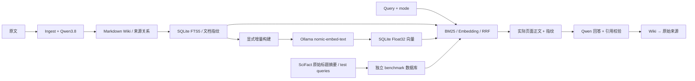

# KnowWeave 项目架构

最后核对：2026-10-17（Asia/Shanghai）。当前实现范围：Round 01 + Round 02。
本文件是当前架构的统一入口；模块、调用链、接口、数据格式、检索/模型协议或部署入口变化时，随代码在同一次提交中更新核对日期。当前名称 **KnowWeave**；既有 `KNOWWAEVE_*` 环境变量和内部包名为兼容保留。

## 技术栈与入口

- Node.js 22、pnpm 10.12.1、TypeScript、Next.js 14 App Router、React 18。
- Markdown 保存原文、Wiki 页面、索引和日志；每个 Wiki 的 `.llm-wiki/meta.sqlite` 保存元数据、FTS5、向量、来源关系、用量和响应缓存。
- `scripts/local.mjs` 启动应用，默认监听 `127.0.0.1:3000`，Wiki 和配置隔离到仓库 `.local/`；Ollama 默认 `127.0.0.1:11434`。通过 VS Code Remote SSH 或 SSH 端口转发访问，无新增登录或云服务。
- Python 标准库用于数据准备和真实 API 验收；TypeScript + tsx 用于调用同一检索核心的离线 benchmark，无新增常驻服务。

## 模块职责与真实调用链

| 模块 | 职责与入口 |
| --- | --- |
| `apps/web` | UI、HTTP 输入校验、模型槽和当前 Wiki 选择；[server-wiki.ts](apps/web/src/lib/server-wiki.ts) 每次请求打开数据库并同步 Markdown |
| `packages/core` | [ingest.ts](packages/core/src/ingest.ts) Wiki 编译；[query.ts](packages/core/src/query.ts) 检索取证和回答；[retrieval.ts](packages/core/src/retrieval.ts) 三模式检索/增量向量构建；[retrieval-store.ts](packages/core/src/retrieval-store.ts) 文档和模型指纹 |
| `packages/llm` | [client.ts](packages/llm/src/client.ts) JSON/重试/响应校验；[ollama.ts](packages/llm/src/ollama.ts) Qwen 原生 chat；[embedding.ts](packages/llm/src/embedding.ts) 原生 embed、模型身份与向量验证 |
| `packages/ingestion` | 文本、URL、文件解析，向 Ingest 提供输入 |
| `scripts` | [scifact.py](scripts/scifact.py) 下载/校验/小样本；[benchmark-scifact.mts](scripts/benchmark-scifact.mts) 原始语料全量评测；[demo_retrieval.py](scripts/demo_retrieval.py) 三模式真实 Qwen/来源核对 |

导入：`POST /api/ingest` → `ingestPastedText` / `ingestSource` → prompt → `callLLM` → `IngestResponseSchema` → `applyIngestResponse`。写入 `raw/`、`wiki/*.md`、`index.md`、`log.md`，维护 `pages`、`pages_fts`、`sources`、`page_sources`；来源 UUID 同时存于 frontmatter。

问答：`POST /api/query` → `queryWiki` → `retrievePages` → 从磁盘 `readPage` → `buildQueryPrompt` → Qwen → `QueryResponseSchema` → 校验引用属于实际供给正文。返回 `pagesUsed` 和 `retrieval`，后者含模式、排名、模型、参数、耗时以及 `suppliedPages` 的正文 SHA256/UTF8 字节数。排名本身不作为模型证据，真正供给的是当前页面正文。无命中直接返回低置信证据不足；低置信模型回答可无引用，其他回答必须有引用。引用存在性不证明科学结论正确。

UI 的 `[[slug]]` 跳到 Wiki，再经 Sources 链接进入原文；读取 API 仍为 `/api/pages/[slug]` 与 `/api/sources/[id]`。Round 02 不改变 Ingest 与聊天的候选检索策略，它们继续使用 BM25；三模式明确用于独立 Query。

## 检索、模型与持久化协议

- BM25：沿用 FTS5 默认 tokenizer/权重，最多 64 个转义词项 OR，按 BM25 和 slug 稳定排序；无额外分词或 stemming。
- Embedding：原始 `title + "\n\n" + content`，Nomic 文档前缀 `search_document: `、问题前缀 `search_query: `，经 L2 归一化后以 little-endian Float32 BLOB 保存。精确余弦扫描全部有效向量；不引入 ANN 或外部数据库。
- Hybrid：每路最多 100 候选、等权 RRF `sum(1/(60 + rank))`，rank 从 1 开始，最终最多 10 页；相同分数以 slug 排序。参数在看 test 结果前固定。纯向量总会给出最近邻，不能把正相似度当作证据充分性阈值，最终由问答判断是否足以回答。
- `retrieval_documents` 保存 slug/title/content/content_hash；`page_embeddings` 保存 slug、content_hash、model_key、模型 JSON、维度、vector、updated_at，外键删除级联。模型键包含实际模型 tag/digest、前缀、请求上下文和输入格式版本，避免不同模型/文本空间混用。
- `indexPageForSearch` 同步 FTS 与检索文档并使变化向量立即失效；`unindexPageFromSearch` / 删除清理文档与向量。创建、Ingest、手工编辑、软删除、恢复和磁盘同步复用这些入口。
- `syncWikiToDb` 迁移时为旧页补齐检索文档，清理磁盘上已消失的页面；每请求同步会发现启动前或应用外修改，不自动调用 Embedding。SQLite 中来源关系、用量并非全部可从 Markdown 恢复，数据库仍应随 Wiki 备份。
- 索引构建是显式、可重试的增量任务。每批独立提交，写回前再次比较内容 hash，期间删除/修改的旧向量不落库。普通查询只生成问题向量；缺失、失效、模型不匹配时清晰拒绝，不静默返回不完整的 Hybrid。

Qwen 仍使用 `qwen3.8:27b`，`/api/chat` 请求级 `num_ctx=32768`、`num_predict=4096`、`think=false`、`temperature=0`，按 UTF8 字节上界加完整输出预算拒绝过长证据。Embedding 使用 `nomic-embed-text:v1.5` 的 `/api/embed`，`truncate:false`，请求 `num_ctx=8192`、默认 120 秒超时，校验数量、有限非零向量与维度。实际服务可能限制有效上下文；请求值不保证 Ollama 采用同样长度，超长输入会明确失败。协议依据 [Ollama embed API](https://docs.ollama.com/api/embed) 与 [Nomic 模型卡](https://huggingface.co/nomic-ai/nomic-embed-text-v1.5)。

## HTTP 与操作入口

| 接口 | 行为 |
| --- | --- |
| `POST /api/query` | `{question, mode?: "bm25"\|"embedding"\|"hybrid", model?}`；省略 mode 为 BM25；响应 `response.retrieval` 记录实际取证 |
| `GET /api/retrieval` | 当前 Wiki 的 total/indexed/pending/ready、模型状态与提示；模型不可用仍可查看本地状态 |
| `POST /api/retrieval` | 空 body 或 `{force:false}` 刷新变化向量，`{force:true}` 全量重建；同 Wiki 同进程构建互斥；成功返回构建数量/耗时，冲突或未就绪为 409，Embedding 故障为 503 |

Query UI 提供模式选择、索引状态、构建/刷新按钮、取证页链接。BM25 保持无需 Embedding 服务，错误不会冒充降级后的成功。所有 Wiki 数据库相互隔离，无全局向量池。

## 评测和验证边界

`pnpm benchmark:scifact` 使用官方 5,183 篇原始标题/摘要、300 条 test queries、339 条相关性标注，直接调用产品 `indexPageForSearch` / `refreshEmbeddings` / `retrievePages`。离线数据库与 Wiki 分离，未调用 Qwen 编译 corpus。使用相同输入和规则宏平均 Recall@10、nDCG@10、MRR@10，记录原文件 hash、模型 digest、参数、索引耗时、含问题向量生成的检索延迟和运行环境。qrels 只用于最终评分，不用于选择融合参数。

实际结果与完整命令见 [Round 02 验收](docs/ROUND_02_ACCEPTANCE.md)；历史 Round 01 数据保留在其报告。大型运行产物、模型、数据库、私有文档与数据集不入 Git。当前精确扫描适合本地中小集合，尚未验证大型 Wiki、并发压力、中文/多语言专项及 PDF/OCR；无 MCP、GraphRAG、登录、微服务和云部署。

## 持续维护

重大决策写入 [DEVLOG](docs/DEVLOG.md)，实现范围写入 [PROGRESS](docs/PROGRESS.md)，区分已实现、实测与未验证。修改路径/接口时核对 README 和 [审阅指南](docs/GPT_REVIEW_GUIDE.md)。代码来源、MIT 与继承/改造边界见 [NOTICE](NOTICE.md)。`docs/PROJECT_OVERVIEW.md` 仅保留架构跳转，不再维护重复正文。

| 日期（Asia/Shanghai） | 变更 |
| --- | --- |
| 2026-10-17 | Round 01 架构迁移至根目录统一入口；Round 02 同步三路检索、向量数据格式和生命周期、在线接口与原始语料评测调用链。 |
