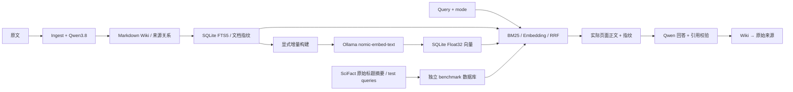

# KnowWeave 项目架构

最后核对：2026-11-12（Asia/Shanghai，完成全站18px界面/20px阅读尺度、双行导航与窄屏栏目选择、英文首页标题、图谱文字尺寸及焦点行为的源码核对）。当前实现范围：Round 01–03、知识工作台、图谱呈现与研究札记视觉升级；本轮验证状态见 [PROGRESS](docs/PROGRESS.md)。
本文件是当前架构的统一入口；模块、调用链、接口、数据格式、检索/模型协议或部署入口变化时，随代码在同一次提交中更新核对日期。当前名称 **KnowWeave**；既有 `KNOWWAEVE_*` 环境变量和内部包名为兼容保留。

## 技术栈与入口

- Node.js 22、pnpm 10.12.1、TypeScript、Next.js 14 App Router、React 18。
- Markdown 保存原文、Wiki 页面、索引和日志；每个 Wiki 的 `.llm-wiki/meta.sqlite` 保存元数据、FTS5、向量、来源关系、用量和响应缓存。
- `scripts/local.mjs` 启动应用，默认监听 `127.0.0.1:3000`，Wiki 和配置隔离到仓库 `.local/`；Ollama 默认 `127.0.0.1:11434`。通过 VS Code Remote SSH 或 SSH 端口转发访问，无新增登录或云服务。
- [.vscode/settings.json](.vscode/settings.json) 配置 Remote SSH 按进程自动发现已监听的 `3000` / `3001`，分别标注默认知识库和演示知识库，并恢复转发；`3000` 新建自动转发时请求打开客户端浏览器，`3001` 静默转发，其他端口默认忽略。应用与模型继续在服务器运行。此工作区配置不负责启动服务器应用；本机端口冲突时以 Ports 面板实际地址为准，恢复已有转发不保证再次打开浏览器。
- 项目诊断入口为 `pnpm run doctor`（`node scripts/local.mjs doctor`），核验 Ollama 服务与生成模型 tag；Nomic 状态由 Query 检索接口核验。`pnpm doctor` 是包管理器内置命令。
- Python 标准库用于数据准备和真实 API 验收；TypeScript + tsx 用于调用同一检索核心的离线 benchmark，无新增常驻服务。

## 模块职责与真实调用链

| 模块 | 职责与入口 |
| --- | --- |
| `apps/web` | UI、HTTP 输入校验、模型槽和当前 Wiki 选择；[server-wiki.ts](apps/web/src/lib/server-wiki.ts) 每次请求打开数据库并同步 Markdown |
| `packages/core` | [ingest.ts](packages/core/src/ingest.ts) Wiki 编译；[query.ts](packages/core/src/query.ts) 检索取证和回答；[retrieval.ts](packages/core/src/retrieval.ts) 三模式检索/增量向量构建；[retrieval-store.ts](packages/core/src/retrieval-store.ts) 文档和模型指纹 |
| `packages/llm` | [client.ts](packages/llm/src/client.ts) JSON/重试/响应校验；[ollama.ts](packages/llm/src/ollama.ts) Qwen 原生 chat；[embedding.ts](packages/llm/src/embedding.ts) 原生 embed、模型身份与向量验证 |
| `packages/ingestion` | 文本、URL、文件解析，向 Ingest 提供输入 |
| `scripts` | [scifact.py](scripts/scifact.py) 下载/校验/小样本；[benchmark-scifact.mts](scripts/benchmark-scifact.mts) 原始语料全量评测；[demo_retrieval.py](scripts/demo_retrieval.py) 三模式真实 Qwen/来源核对 |

导入：`POST /api/ingest` → `ingestPastedText` / `ingestSource` → prompt → `callLLM` → `IngestResponseSchema` → `applyIngestResponse`。新来源使用 `raw/<date>-<slug>-<source UUID>.<ext>` 排他创建，避免同名导入覆盖原文；旧文件名仍可读取。写入 `wiki/*.md`、`index.md`、`log.md`，维护 `pages`、`pages_fts`、`sources`、`page_sources`；来源 UUID 同时存于 frontmatter。Ingest 在同 Wiki 的应用进程内互斥写入，写页前拒绝同一提案重复 slug 或把现存页当作 newPage；失败来源保持 pending，可在 Sources Retry。Ingest 和手工创建/编辑均读取序列化后实际落盘正文用于索引与返回值，并等待同步状态完成，保证新建/更新内容与 Query 的正文指纹相同。此互斥不覆盖多个服务进程或外部编辑器并发。

问答：`POST /api/query` → `queryWiki` → `retrievePages` → 从磁盘 `readPage` → `buildQueryPrompt` → Qwen → `QueryResponseSchema` → 校验引用属于实际供给正文。返回 `pagesUsed` 和 `retrieval`，后者含模式、排名、模型、参数、耗时以及 `suppliedPages` 的正文 SHA256/UTF8 字节数。排名本身不作为模型证据，真正供给的是当前页面正文。无命中直接返回低置信证据不足；低置信模型回答可无引用，其他回答必须有引用。引用存在性不证明科学结论正确。

UI 的 `[[slug]]` 跳到 Wiki，再经 Sources 链接进入原文；读取 API 仍为 `/api/pages/[slug]` 与 `/api/sources/[id]`。Round 02–03 不改变 Ingest 与聊天的候选检索策略，它们继续使用 BM25；三模式明确用于独立 Query。

聊天：`/chats` 布局显式使用 `force-dynamic`，访问时按当前 Wiki 的主题和 Chat 模型槽执行 `requireSetup("chat")`，避免把构建时的未配置跳转永久缓存。新建会话经 `POST /api/chats` 进入 `/chats/[id]`；发送经 `POST /api/chats/[id]/messages` → `sendChatMessage` → `chatComplete` → Ollama，保存会话 Markdown 与 SQLite 元数据。浏览器只调用本站 API，无需转发 Ollama 端口；当前回复完整生成后一次返回。

## 专题与个人阅读工作台

`/workspace` 使用 `openWikiContext` → [workspace.ts](packages/core/src/workspace.ts) 的 `getWorkspaceSnapshot`，读取当前 Wiki 的页面、专题、收藏、阅读进度和个人笔记。`WorkspaceView` 提供专题创建/编辑/删除、加入/移出页面、搜索与状态筛选；`?collection=<id>&status=reading&starred=1` 可进入指定视图。[PageWorkspaceActions](apps/web/src/components/wiki/page-workspace-actions.tsx) 供阅读页收藏、标记阅读和保存专题/笔记。写入后刷新服务端路由数据，切换 Wiki 以 Wiki 身份重新挂载客户端状态。

每个 `.llm-wiki/meta.sqlite` 幂等新增三表：`workspace_collections(id,title,description,created_at,updated_at)`、`page_workspace(page_slug,starred,reading_status,note,updated_at)`、`workspace_collection_pages(collection_id,page_slug)`。记录引用 `pages.slug`，关系引用专题；外键级联清理。`unread/reading/reviewed` 只表示个人阅读进度，默认未读，不表示事实审查或模型置信度。专题允许多对多归类；名称最长 120、说明 2000、笔记 20000 字符；修改使用事务，先验证所有专题存在再写入，拒绝未知字段。笔记不改正文/来源/向量，也不传给模型。

删除专题只移除归类，保留 Wiki 与个人笔记。通过产品软删除页面时，[editor.ts](packages/core/src/editor.ts) 先写 `.llm-wiki/trash/wiki/<trashFilename>.workspace.json`（`version:1`，保存 slug、收藏、阅读状态、笔记与专题 ID），再移入 Markdown 并删除数据库记录。撤销先校验 sidecar，再恢复页面与个人记录，仅恢复仍存在的专题；旧回收文件没有 sidecar 仍可恢复。两文件保留期从删除时开始，沿用 30 日清理。外部直接删除 Markdown 不经过此恢复流程；文件和数据库仍非跨介质事务。

`GET /api/wikis/export` 在现有文档 ZIP 中加入 SQLite `backup` 生成的一致快照 `.llm-wiki/meta.sqlite`，保留专题、笔记、来源关系等不可从 Markdown 重建的信息。临时快照在成功/失败后清理，ZIP 使用已安装 archiver v8 的 `ZipArchive`。设置、历史和回收站仍不包含；数据库快照与 Markdown 文件拷贝不构成统一时点事务，宜在停止编辑/导入后导出。还原时先停止应用，将 ZIP 解压到目标 Wiki 后重新配置模型；不要把该包称为包含全部配置/历史的完整备份。下载继续在内存缓冲，超大库未验证。

| 接口 | 契约 |
| --- | --- |
| `GET /api/workspace` | `{collections,pages,summary}`；pages 含 `starred,readingStatus,note,collectionIds,touchedAt`，summary 为真实状态计数 |
| `POST /api/workspace/collections` | `{title,description?}`，创建专题 |
| `PATCH /api/workspace/collections/[id]` | `{title?,description?}`，同名返回 409 |
| `DELETE /api/workspace/collections/[id]` | 删除专题和归类关系，保留页面 |
| `GET /api/workspace/pages/[slug]` | `{page,collections}`，为阅读页载入个人记录与可选专题 |
| `PATCH /api/workspace/pages/[slug]` | 部分更新 `{starred?,readingStatus?,note?,collectionIds?}`；明确给出 collectionIds 才整体替换该页归类；返回 `{page}` |

输入错误为 400、不存在为 404、名称冲突为 409；每请求关闭数据库。继续沿用本机单用户部署，无新增身份认证或跨进程编辑锁。UI 与测试入口及产品取舍见 [产品升级记录](docs/PRODUCT_UPGRADE.md)。

## 网页语言与知识图谱

### 馆藏、阅读与回答复用

首页是运行时读取的知识工作台：`listPageRows/listSourceRows/listChatRows/getWorkspaceSnapshot` 提供真实近期更新、待处理来源和阅读进度，不调用模型。深红「阅读札记」按在读页面、收藏页面、最近页面的优先级选择一个真实页面；各组沿用 workspace 按个人记录更新时间（无记录则为页面更新时间）倒序、slug 决胜的顺序，展示其已有专题、标题和个人笔记。空库显示添加资料入口；近期页面列表仍独立按页面更新时间排序。双层导航保留各路由、Workspace 与可点击搜索入口，首次引导条件不变，入口不展示 Wiki 绝对路径。

[globals.css](apps/web/src/app/globals.css) 维护绛红、暖纸、象牙与墨褐的语义色值和深浅双主题，主题继续复用现有本地偏好；标题与长文使用本地衬线/宋体字体栈，操作区使用本地无衬线字体栈，不请求外部字体。[WeaveMark](apps/web/src/components/weave-mark.tsx) 提供导航品牌的交织 SVG 标记；首页交织线条亦由 SVG 绘制。[home.module.css](apps/web/src/app/home.module.css)、[library.module.css](apps/web/src/app/wiki/library.module.css) 与 [workspace.module.css](apps/web/src/app/workspace/workspace.module.css) 分别约束首页札记、馆藏索引行、专题书签和连续阅读列表样式，避免跨页选择器覆盖。桌面首页左右分栏、窄屏顺序堆叠，沿用共享键盘焦点与减少动效规则。此次呈现变化不修改接口、存储、检索或模型协议。

共享字号由 [tailwind.config.ts](apps/web/tailwind.config.ts) 统一：`text-xs/text-caption` 为 16px，`text-sm/text-ui/text-base` 与普通输入为 18px，`text-body` 与 Markdown 阅读为 20px（均用 rem 定义，按默认根字号换算）；页脚与快捷键提示为 15px。首页、馆藏和专题 CSS modules 沿用对应尺度，普通输入高48px，共用按钮最小44px；窄屏通过换行和控件增高容纳文字，不缩小阅读字号。Graph 节点标签使用14px以控制密度，信息区和操作提示为16px，避让尺寸与实际绘制同步。首页主标题为 `Where knowledge weaves together.`，标记 `lang="en"` 并保留两行排版；「最近更新的知识」类型标签为 `Entity / Concept / Source / Comparison / Overview`，类型枚举与其他页面语言不变。

[AppHeader](apps/web/src/components/app-header.tsx) 与独立 [app-header.module.css](apps/web/src/components/app-header.module.css) 管理导航：1280px及以上使用八列双行入口，栏目名20px/说明16px、点击区至少80px高；较窄窗口显示当前栏目和「切换栏目」，展开同一组路由及辅助入口。桌面主导航支持方向键、Home/End移动焦点；展开菜单聚焦当前页、Escape回到触发器，移出焦点/外部点击/切换路由关闭，跨断点隐藏控件时恢复可见焦点。手机主题切换位于菜单内，搜索通过既有命令面板事件打开并显示平台快捷键。Wiki切换器使用普通按钮披露列表、44px操作区和完整长名称，支持打开聚焦、Escape回焦及外部关闭；切库接口保持不变。

Wiki 与 Chats 共用 [SidebarLayoutWrapper](apps/web/src/components/sidebar-layout-wrapper.tsx) 和独立 CSS module：窄屏关闭侧栏时隐藏可见性并设置原生 `inert`；打开后正文区暂时 inert，焦点限制在侧栏内，Escape 或遮罩关闭返回触发按钮，路由切换关闭时处理侧栏内遗留焦点。React 18 下通过 DOM 属性设置 inert，避免 JSX 属性序列化差异。桌面侧栏继续常显；切换断点清除移动展开状态。

共享按钮提供轻微按压反馈；栏目菜单、Wiki切换和低频展开区仅在指针操作时使用短入场动效，键盘与高频搜索立即响应。动效只改变透明度/变换，hover样式限制在精确指针设备，减少动态效果设置禁用位移。专题新建/编辑表单打开后聚焦名称，取消或保存后恢复触发器焦点；阅读笔记展开仍保留本地草稿。没有新增动画库、外部字体或后端协议。

`/wiki` 从 `listPageRows` 与 `index.md` 的摘要构建馆藏，以类型签条、标题摘要、标签和更新日期组成索引行；`/workspace` 用专题书签选择、状态筛选横条和连续阅读条目呈现已有专题与个人笔记。馆藏 GET 参数 `q/type/tag/sort` 支持标题、slug、标签和目录摘要搜索、组合筛选，以及最近/最早/标题排序。重复查询参数先归一为单个值。该目录查找不是正文全文或语义检索。新建笔记沿用 `POST /api/pages`，不调用模型；空库与删除最后一页均保留新建/撤销入口。

阅读页集成个人状态组件，根据已渲染 Markdown 标题生成页内目录；阅读时间分别粗估中文字数与字母词数，不作为实际阅读计时。单页 Markdown 下载包含正文、类型/日期/标签和已知来源 ID，不包含原文文件及个人笔记。Wiki 详情和侧栏按 Wiki 路径的 SHA256 key 重挂载，避免同 slug 切库后的旧状态残留。命令面板支持 `knowweave:open-search` 事件与 Cmd/Ctrl+K，渲染顺序和键盘选择统一，包含 Workspace 入口；独立 CSS module 约束手机视口内的结果滚动。搜索输入使用 combobox/listbox 关系，支持方向键选择、Tab循环、Escape关闭回焦，兼容中文输入法，关闭时取消未完成的读取请求。

Sources 列表在已有返回数据上按标题/文件名/网址、处理状态、格式过滤，每次显示 12 项并可继续加载；`?status=pending` 进入待处理列表。导入、审批、Retry 和删除仍走原接口。

Query 提供比较研究、简报、决策问题模板，仅填写输入框，不自动提交。每次响应记录对应的实际提交问题，后续编辑输入不会改变该回答的题目。客户端 [answer-export.ts](apps/web/src/lib/answer-export.ts) 将问题、回答、引用、模型、模式、置信度和局限一起复制/下载为 Markdown；仅把 `pagesUsed` 中的 Wiki 引用转换成当前实例 URL。链接仍需该实例可访问，置信度明确标为模型判断。没有增加浏览器回答历史、模型调用或检索协议。

- 界面采用英文栏目/技术术语（Sources、Wiki、Query、BM25 等）与中文操作说明；`html lang="zh-CN"`，帮助页、导入/问答/聊天、Wiki 和主要设置操作提供中文指引。用户资料与 Wiki 正文不因界面语言而翻译，不新增翻译服务。
- `/graph` 继续由服务端 `openWikiContext` → `buildGraph` 读取现有页面与 `[[slug]]` 引用，返回原有 `GraphData {nodes, links}`；断链、自引用、重复同向边沿用 core 规则。有向关联表示页面引用，不代表语义相似度或模型推断关系。
- [vault-graph.tsx](apps/web/src/components/graph/vault-graph.tsx) 管理 Map · 2D / Space · 3D、搜索、类型筛选、选择详情与悬停/选择邻接高亮；`?node=<slug>` 保留深链接。两种视图共享筛选、选择、「仅看相邻」和标签开关，视图偏好保存在浏览器 `knowweave.graph.mode`；首次默认 2D，浏览器存储不可用时仍可切换。未选择时展示当前筛选结果中按原图关联数量排序的最多四个页面入口；排序不表示内容质量或模型相关性。全屏使用原生 Fullscreen API，仅在浏览器支持时提供入口。
- [graph-layout.ts](apps/web/src/components/graph/graph-layout.ts) 提供确定性二维布局与过滤，160 节点以内执行有界布局迭代，更多节点采用网格控制开销。新增 `neighborhoodGraph` 先保留所选节点及所有直接引用/被引用邻居构成的诱导子图，再应用标题/标签/类型筛选；邻居彼此的实际引用仍保留，不生成推断边，不改输入或原图 degree。缺失选择返回原图，清除选择退出局部范围。
- Map 使用 SVG 珠光渐变节点、曲线引用、选择环与固定屏幕字号的标签底板；支持缩放平移与键盘选择。[graph-labels.ts](apps/web/src/components/graph/graph-labels.ts) 统一标签实际绘制与布局所用的屏幕尺寸，以14px字号/20px行高测量并绘制，依次尝试下、上、右、左四个方向，窄画布增加紧邻节点的四个角向候选并缩短每行标题长度，避开全部可见节点、已有标签、画布信息区与工具条；优先当前选择/悬停与高关联节点，关闭普通标签后仍允许显示当前选择或悬停提示。[graph.module.css](apps/web/src/components/graph/graph.module.css) 维护图谱专属画布、面板层次、全屏布局和减少动态效果样式；桌面画布与侧栏同高，侧栏内容独立滚动，不覆盖其他路由。
- [spatial-graph.tsx](apps/web/src/components/graph/spatial-graph.tsx) 仅在选择 Space 时动态加载现有 `react-force-graph-3d`，使用独立数据副本与固定空间坐标，避免模拟漂移或修改共用图数据。[spatial-materials.js](apps/web/src/components/graph/spatial-materials.js) 封装现有 Three.js 的球体、珠光材质、光晕/选择环与主题化光源；镜头按节点边界与画布比例取景，屏幕投影标签按实际单/双行高度和宽度避开其他标签、可见节点圆、信息区与控件，并隐藏相机背面标签；标题与副标均为14px。用户主动开启「缓慢环绕」后才自动旋转，拖动、选择和镜头操作会暂停；`prefers-reduced-motion` 禁用环绕与相机过渡。
- 画布与详情在窄屏上下排列；WebGL2 不可用或上下文丢失时显示切换至 2D 的入口。节点位置仅用于图谱呈现，距离不表示语义相似度。图谱是浏览与跳转工具，不改变 Wiki、检索、模型或持久化接口，也不引入 GraphRAG 或新的运行依赖。

### Lint 中文交互与报告

`/lint` 继续使用 `POST /api/lint` → `lintWiki`：本地扫描页面引用，模型分析矛盾、缺口、过时表述与缺页，记录日志/用量；检查本身不改 Wiki 正文。语义检查最多取按 slug 排序的 60 页，每页正文最多 800 个按空白切分的词项，界面对部分覆盖给出提示，不宣称完整事实核查。

[lint-presentation.ts](apps/web/src/app/lint/lint-presentation.ts) 只将已识别的本地断链/缺少引用报告映射成中文展示，未知内容保留原文。原始 `description` / `suggestedFix` 仍供现有修复目标解析使用；UI 的严重程度、问题类型、来源和模型评估均映射中文，历史 UTC 日志仅在显示时转换为北京时间。

[Lint prompt](packages/core/src/prompts/lint.ts) 要求问题说明、建议与后续问题使用简体中文，保留 JSON 字段、枚举、准确 slug、页面标题和原文引用；缺页描述保留 `slug + 空格` 前缀。[修复 prompt](packages/core/src/lint-fixes.ts) 的 `changeSummary` 使用中文，`newContent` 保持原页面语言。修复按钮继续走既有 `/api/lint/fix` 并写入页面/历史；「重建页面目录」仅更新 `index.md`，不是向量索引刷新。接口结构、存储格式和修复审批行为未改变。

## 检索、模型与持久化协议

- BM25：沿用 FTS5 默认 tokenizer/权重，最多 64 个转义词项 OR，按 BM25 和 slug 稳定排序；无额外分词或 stemming。
- Embedding：原始 `title + "\n\n" + content`，Nomic 文档前缀 `search_document: `、问题前缀 `search_query: `，经 L2 归一化后以 little-endian Float32 BLOB 保存。精确余弦扫描全部有效向量；不引入 ANN 或外部数据库。
- Hybrid：每路最多 100 候选、等权 RRF `sum(1/(60 + rank))`，rank 从 1 开始，最终最多 10 页；相同分数以 slug 排序。参数在看 test 结果前固定。纯向量总会给出最近邻，不能把正相似度当作证据充分性阈值，最终由问答判断是否足以回答。
- `retrieval_documents` 保存 slug/title/content/content_hash；`page_embeddings` 保存 slug、content_hash、model_key、模型 JSON、维度、vector、updated_at，外键删除级联。模型键包含实际模型 tag/digest、前缀、请求上下文和输入格式版本，避免不同模型/文本空间混用。
- `indexPageForSearch` 同步 FTS 与检索文档并使变化向量立即失效；`unindexPageFromSearch` / 删除清理文档与向量。创建、Ingest、手工编辑、软删除、恢复和磁盘同步复用这些入口。
- `syncWikiToDb` 迁移时为旧页补齐检索文档，清理磁盘上已消失的页面；每请求同步会发现启动前或应用外修改，不自动调用 Embedding。SQLite 中来源关系、用量并非全部可从 Markdown 恢复，数据库仍应随 Wiki 备份。
- 索引构建是显式、可重试的增量任务。每批独立提交，写回前再次比较内容 hash，期间删除/修改的旧向量不落库。普通查询只生成问题向量；缺失、失效、模型不匹配时清晰拒绝，不静默返回不完整的 Hybrid。

Qwen 仍使用 `qwen3.8:27b`，`/api/chat` 请求级 `num_ctx=32768`、`num_predict=4096`、`think=false`、`temperature=0`，按 UTF8 字节上界加完整输出预算拒绝过长证据。Embedding 使用 `nomic-embed-text:v1.5` 的 `/api/embed`，`truncate:false`，请求 `num_ctx=8192`、默认 120 秒超时，校验数量、有限非零向量与维度。实际服务可能限制有效上下文；请求值不保证 Ollama 采用同样长度，超长输入会明确失败。协议依据 [Ollama embed API](https://docs.ollama.com/api/embed) 与 [Nomic 模型卡](https://huggingface.co/nomic-ai/nomic-embed-text-v1.5)。

## HTTP 与操作入口

| 接口 | 行为 |
| --- | --- |
| `POST /api/query` | `{question, mode?: "bm25"\|"embedding"\|"hybrid", model?}`；省略 mode 为 BM25；响应 `response.retrieval` 记录实际取证 |
| `POST /api/sources/[id]/retry` | 重试尚未完成的来源；响应与 Ingest 一致（`kind: applied/preview`、`fullResponse`），遵守审批设置；已完成来源再次 Retry/Apply 返回 409。PDF/图片需转文本或重新上传，Office 文件重新提取 |
| `POST /api/sources/[id]/delete` | 删除来源；除原文件已不存在外，I/O 失败保留记录；若历史其他来源共享同一原文件则保留文件 |
| `GET /api/retrieval` | 当前 Wiki 的 total/indexed/pending/ready、模型状态与提示；模型不可用仍可查看本地状态 |
| `POST /api/retrieval` | 空 body 或 `{force:false}` 刷新变化向量，`{force:true}` 全量重建；同 Wiki 同进程构建互斥；成功返回构建数量/耗时，冲突或未就绪为 409，Embedding 故障为 503 |

Query UI 提供模式解释、索引状态、构建/刷新按钮、取证页链接；空 Wiki 显示先导入，刷新显示新建/复用数量，失败后重读实际状态，模式切换和窗口聚焦时重新核对。Sources 失败后刷新 pending 列表，同页 Retry 与新 Ingest 互斥；重复导入仍是新来源，失败应使用 Retry 复用原文。Wiki 显示已删除来源计数，原文详情默认展示相对路径。BM25 保持无需 Embedding 服务，错误不会冒充降级后的成功。所有 Wiki 数据库相互隔离，无全局向量池。

## 评测和验证边界

知识工作台升级的 [prepare-workspace-demo.mts](scripts/prepare-workspace-demo.mts) / `pnpm demo:workspace:prepare [新空目录]` 创建明确标记的人工演示 Wiki 与独立配置（16 页、原文样例、两个专题、阅读记录），不调用模型，拒绝非空目录。用环境变量指定它们启动独立实例。[workspace-browser.mjs](scripts/workspace-browser.mjs) 要求 loopback、服务端返回的准确 Wiki 路径和固定演示主题/页面，使用真实 Chromium 输入与鼠标操作检验工作流和响应式界面，拒绝覆盖已有报告。它不运行生成模型；真实 Qwen、下载、跨 Wiki 与部署验证另行记录。两种演示不能替代 SciFact 评测，具体结果见 [产品升级记录](docs/PRODUCT_UPGRADE.md)。

[prepare-graph-demo.mts](scripts/prepare-graph-demo.mts) 默认在新的空目录 `.local/graph-demo` 生成独立 Wiki/config 与 `fixture.json`：18 页、33 条引用，主题 `KnowWeave Graph QA`，包含双向引用与孤立页面，不调用模型，拒绝非空目录；已纳入 [scripts/tsconfig.json](scripts/tsconfig.json) 的类型检查。[graph-browser.mjs](scripts/graph-browser.mjs) 是对应只读浏览器验收入口，要求 loopback、准确 Wiki 路径和指定人工样例；记录真实 Chromium 鼠标/键盘操作、截图、浏览器/HTTP 错误与意外写请求，提供 `full` / `fallback` 场景。普通场景使用软件 WebGL，回退场景禁用 WebGL；不调用模型，不向 Wiki 写入页面，不作为实际 GPU、大规模图谱或手机触控性能结论。复现命令见 [README](README.md#图谱视觉演示)，当前运行结果统一记录在 [DEVLOG](docs/DEVLOG.md)。

`pnpm benchmark:scifact` 使用官方 5,183 篇原始标题/摘要、300 条 test queries、339 条相关性标注，直接调用产品 `indexPageForSearch` / `refreshEmbeddings` / `retrievePages`。离线数据库与 Wiki 分离，未调用 Qwen 编译 corpus。使用相同输入和规则宏平均 Recall@10、nDCG@10、MRR@10，记录原文件 hash、模型 digest、参数、索引耗时、含问题向量生成的检索延迟和运行环境。qrels 只用于最终评分，不用于选择融合参数。

`scripts/demo_round03.py` 面向独立空 Wiki，先核对服务器目录、模型槽与官方数据指纹，顺序导入两篇原文，记录实际 LLM 旧页更新；再单独标注一次手工跨文档阅读列表编辑，验证单页失效、Hybrid 409、刷新 1 页/重复刷新 0 页和三模式引用与原文完整性。`scripts/demo-browser.mjs` 使用本机 Chromium DevTools 协议，首次通过 UI 导入第三篇、浏览 Wiki、刷新索引、三模式提问并点击引用到原文，直接截图；无新增浏览器 npm 依赖。详见 [Demo 说明](docs/DEMO.md) 与 [Round 03 验收](docs/ROUND_03_ACCEPTANCE.md)。

Round 02 历史检索结果与完整命令见 [Round 02 验收](docs/ROUND_02_ACCEPTANCE.md)；历史 Round 01 数据保留在其报告。大型运行产物、模型、数据库、私有文档与数据集不入 Git。当前精确扫描适合本地中小集合，尚未验证大型 Wiki、并发压力、中文/多语言专项及 PDF/OCR；无 MCP、GraphRAG、登录、微服务和云部署。

## 源码仓库与发布入口

私有开发与本架构文档位于 [KnowWeave-Dev](https://github.com/ck-alpha/KnowWeave-Dev)，保留历史及验收；独立 [KnowWeave](https://github.com/ck-alpha/KnowWeave) 为全新历史的公开源码快照。公开版不复制 docs/ 或开发指令，关键调用链与使用说明放在 README。两处 Git origin 完全分离，具体基线、文件范围和验证见 [发布记录](docs/PUBLIC_RELEASE.md)。

公开版将相同演示脚本命名为 `scripts/demo_wiki.py` / `pnpm demo:wiki`，其对应的 Python 测试同步改名；演示结果使用不含轮次的本地路径。产品运行协议、模型、存储、检索核心与本文件描述一致，未因发布增加服务或改变部署边界。

## 持续维护

重大决策写入 [DEVLOG](docs/DEVLOG.md)，实现范围写入 [PROGRESS](docs/PROGRESS.md)，区分已实现、实测与未验证。修改路径/接口时核对 README 和 [审阅指南](docs/GPT_REVIEW_GUIDE.md)。代码来源、MIT 与继承/改造边界见 [NOTICE](NOTICE.md)。`docs/PROJECT_OVERVIEW.md` 仅保留架构跳转，不再维护重复正文。

| 日期（Asia/Shanghai） | 变更 |
| --- | --- |
| 2026-11-12 | 整站普通文字/操作18px、阅读20px、辅助16px，首页标题改英文；新增导航CSS module、桌面双行栏目与窄屏栏目菜单，补齐焦点行为；放大2D/3D标签并同步碰撞范围，后端接口与数据不变。 |
| 2026-11-12 | 统一14px标签、15px操作、16px说明/输入和18px阅读尺度，治理显式小字号并同步控件/窄屏排版；首页近期页面类型改英文，数据与接口不变。 |
| 2026-11-12 | 首页改为真实阅读札记，按在读/收藏/最近选择页面；馆藏与专题采用索引布局，新增独立 CSS modules 与交织 SVG 品牌，统一本地字体和双主题，补齐移动侧栏隐藏焦点及 Escape 关闭行为；接口、存储、检索和模型协议不变。 |
| 2026-11-12 | Graph 新增一跳诱导子图、共享标签开关、原生全屏及实际关联排序入口；升级 SVG/Three.js 呈现、屏幕标签四向避让、主题光照、显式环绕和减少动效，新增人工图谱样例与只读浏览器验收入口，无后端协议或依赖变化。 |
| 2026-11-12 | 首页改为真实知识工作台，双层导航与响应式主题统一；新增人工样例生成与真实浏览器验收脚本，沿用本地部署。 |
| 2026-11-12 | Wiki 馆藏组合筛选、新建笔记、阅读目录/导出；Sources 筛选；Query 模板与带引用导出；命令面板与切库状态修复。 |
| 2026-11-12 | 新增每 Wiki 专题/收藏/阅读状态/个人笔记及工作台 HTTP；软删除 sidecar 恢复个人记录，ZIP 包含 SQLite 一致快照。 |
| 2026-11-12 | Lint 提供中文交互与报告提示词；本地结果仅展示层映射，保留机器字段/修复目标与正文语言，历史时间显示为北京时间。 |
| 2026-11-12 | 增加中英混合界面、Map/Space 双图谱视图、共享筛选与深链接；继续使用既有 GraphData、Wiki 引用和 3D 依赖，无后端协议变化。 |
| 2026-11-12 | 修复 Chat 索引页生产构建缓存 setup 跳转的问题；Chat 布局按运行时 Wiki 配置动态渲染，聊天接口与模型协议不变。 |
| 2026-11-12 | 增加 Remote SSH 工作区端口自动转发与浏览器打开配置；复用既有服务器应用，运行监听与模型协议不变。 |
| 2026-10-17 | 分离私有开发仓库与全新公开源码快照；记录公开演示入口命名及仓库边界，运行架构未变。 |
| 2026-10-17 | 公开前核对诊断入口为 `pnpm run doctor`；仅修正文档，运行架构与 Round 02 检索协议未变。 |
| 2026-10-17 | Round 03 补齐来源独立文件、Ingest 写入保护与正文索引一致性、Retry 审批、索引反馈及双层演示入口。 |
| 2026-10-17 | Round 01 架构迁移至根目录统一入口；Round 02 同步三路检索、向量数据格式和生命周期、在线接口与原始语料评测调用链。 |
