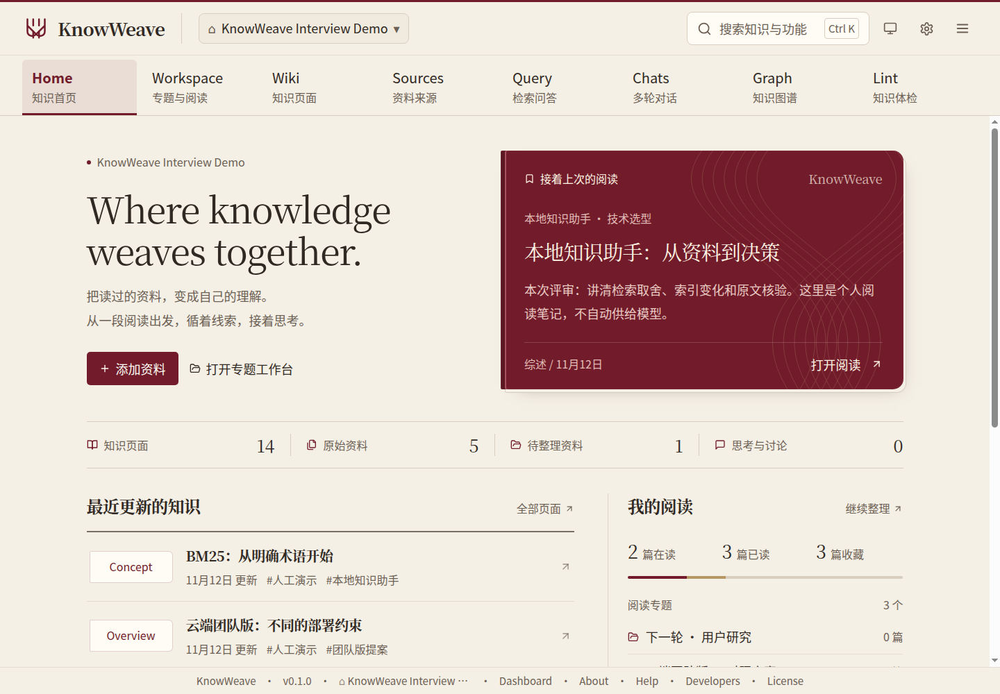
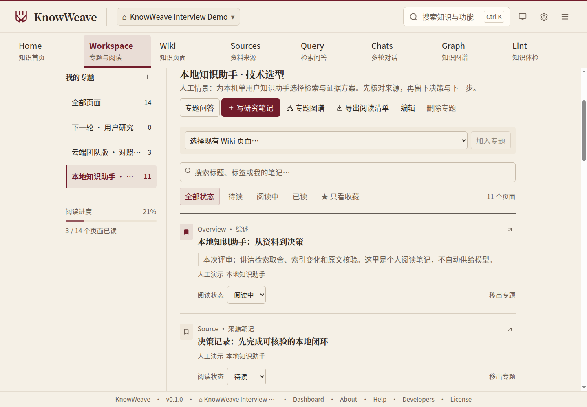

# KnowWeave 面试 Demo：从资料到可核对的技术决策

更新：2026-11-12（Asia/Shanghai）。面向 **AI 产品经理岗位，主流程 5–8 分钟**，另附 3 分钟版本、技术追问和故障后备方案。

这份 Demo 的主线是：**为一个本地知识助手做技术选型，整理资料、比较检索方案、核对回答依据，并留下下一步决策。** 不需要面试官先理解 SciFact 或医学论文。

演示库是明确标记的人工资料，调用真实应用和数据库。预置 Wiki、来源、专题与摘录用于稳定展示；只有现场或彩排中实际发生的模型请求，才能称为模型整理或生成。当前实际验证结果以 [PROGRESS](PROGRESS.md) 和 [DEVLOG](DEVLOG.md) 为准。

## 先准备好可演示的实例

在仓库根目录操作。环境要求与安装步骤见 [README](../README.md#最简启动)。准备器不会下载模型；完整三模式彩排需要 Ollama 的生成与向量模型，单独 BM25 问答仅需要生成模型。

```bash
pnpm demo:interview:prepare
pnpm demo:interview:start
```

打开 <http://127.0.0.1:3002>。启动终端保持运行，在另一个终端执行：

```bash
pnpm demo:interview:check
```

默认数据位于 `.local/interview-demo`，Wiki 与配置独立于日常库；启动器在该目录的 `builds/` 中创建隔离源码快照，首次构建，后续复用相同源码产物。默认 HTTP 预检不生成答案。提前运行真实模型彩排：

```bash
pnpm demo:interview:check --model
```

这会实际构建 Nomic 索引、运行 BM25 / Embedding / Hybrid 回答并检查空专题，报告与实际回答保存到 `.local/interview-demo/reports/check-<timestamp>/report.json` 和 `answers.md`。报告记录实际结果，模型未通过时不要将其当作成功彩排。

本次已在当前服务器实际跑通三模式回答、真实导入以及浏览器演示，结果摘要见 [本轮验收记录](evidence/INTERVIEW_DEMO_RESULTS.json)。默认演示库保留 14 页和待处理来源；真实导入发生在另一份彩排库。若当前服务器终端找不到 `node/pnpm`，可先执行 `export PATH=/opt/knowwaeve-node/bin:$PATH`；这是本机已有安装位置，其他机器按自己的 Node/pnpm 安装方式配置。

准备器拒绝覆盖非空目录，重复启动不必重新准备。需要恢复初始样例时换新目录：

```bash
pnpm demo:interview:prepare .local/interview-rehearsal-02
pnpm demo:interview:start --dir .local/interview-rehearsal-02 --port 3002
# 另一个终端
pnpm demo:interview:check --dir .local/interview-rehearsal-02 --port 3002 --model
```

先按 `Ctrl-C` 停止上一场的演示服务，再启动同端口的新场次。启动器只停止自己创建的进程组，拒绝使用 `3000/3001`。旧库、录屏与报告继续保留。

生成模型可在首次准备前通过 `OLLAMA_MODEL` 选择实际已安装的 tag。已有库的设置不会因再次启动而自动重写；模型配置的完整说明见 README。

若在 Remote SSH 服务器运行，`3002` 需要在 VS Code 的 Ports 面板手动转发。也可以在浏览器所在电脑执行：

```bash
ssh -N -L 13002:127.0.0.1:3002 <账号>@<服务器>
```

然后访问 <http://127.0.0.1:13002>。远程浏览器只访问应用端口，不需要转发 Ollama 端口。后文页面链接的端口以实际转发地址为准。

### 样例里有什么

| 材料                               | 演示作用                                                                 |
| ---------------------------------- | ------------------------------------------------------------------------ |
| 14 篇人工 Wiki                     | 包含概览、方案比较、索引生命周期、证据链、待验证问题，形成可阅读的知识层 |
| 本地知识助手 · 技术选型            | 主专题，聚焦本地单用户产品                                               |
| 云端团队版 · 对照方案              | 明确不同的部署约束，展示专题隔离和跨专题引用                             |
| 下一轮 · 用户研究                  | 空专题，展示“无资料就先补证据”的状态                                     |
| 收藏、阅读中与个人笔记             | 展示持续阅读的工作台，而非一次性问答                                     |
| 两条预置原文摘录                   | 展示保存证据、独立批注、返回精确原文位置                                 |
| 补充评审：先验证，再扩展（待整理） | 供可选的真实 Qwen 导入演示使用                                           |

生成的 `fixture.json` 保存本次专题、来源和摘录的真实 ID，以及页面入口。初始主专题 11 页、对照专题 3 页（共用 1 页），全库 14 页、38 条实际引用、5 份来源（含 1 份待处理）。通过 Workspace 的专题按钮进入即可，不需要手动拼 UUID。

### 可选：自动走一遍真实浏览器彩排

已有 Chromium 时，可用专用脚本收集截图和真实下载。输出目录必须尚不存在，脚本会创建它；浏览器路径填写本机实际可执行文件：

```bash
node scripts/interview-demo-browser.mjs \
  --fixture .local/interview-demo/fixture.json \
  --base-url http://127.0.0.1:3002 \
  --chromium /path/to/chromium \
  --output-dir .local/interview-browser-rehearsal \
  --3d --model
```

`--model` 会通过真实界面提交 BM25 问答并下载回答；`--3d` 检查三维视图。省略两项可检查基础工作流而不发起问答，包括专题、阅读清单与摘录下载、原文定位、模板预填后取消、空专题和窄屏。此脚本的交互检查不能替代你亲自讲述一遍，也不能替代用户研究。

### 面试前 15 分钟检查

- 打开首页、主专题、Query 和 Graph，确认显示演示库标题与中文样例；浏览器缩放保持 100%，关闭无关标签页和通知。
- 用下文主问题完成一次真实问答，点击回答中的一个 Wiki 引用，再打开原始来源。回答文本可变化，链路必须走通。
- 需要展示 Embedding / Hybrid 时，提前点击 Query 的“构建 / 刷新向量索引”，确认当前范围全部就绪。正式演示中修改或新增 Wiki 后要再次刷新。
- 下载一份阅读清单和一份真实回答 Markdown，放入本机容易找到的目录。打开下载内容，确认问题、范围、引用和个人记录标记正确。
- 本机保存一份自己的彩排录屏；如果服务器或模型临时不可用，能直接播放。已有仓库截图也可做静态后备，须说明它们来自历史版本的实际验收。
- 判断演示路径：模型可用走完整流程；只有应用可用走产品工作流；应用也无法访问时使用录屏、截图和源码。不要把后备材料描述为现场生成。

**BM25 只是不需要向量模型。生成有命中的回答仍需要已配置的 Qwen。** Ollama 全部离线时，可以浏览、做阅读记录、管理专题、摘录和导出，不能承诺完整问答可用。

## 开场：先让面试官知道要看什么

可以用自己的语言讲，以下约 35 秒：

> KnowWeave 是我用 AI 辅助编码、基于开源 LLM Wiki 二次开发的本地知识工作台。它面向资料读过却难找回依据的问题，把专题阅读、引用问答和原文核对连起来。这次用技术选型展示：用户能否从问题走到可复核的决策。预置内容是人工样例，提问使用真实本地模型。目前还没有正式用户研究，我会区分已跑通的能力和待验证的价值。

“我负责”“我实现”应按自己的实际参与程度调整。能解释决策、复核代码并运行验证，才把相应内容列为自己的工程能力；无需掩饰 AI 参与，也无需声称每行代码都是手写。

## 给招聘官的一页产品介绍

| 项目             | 可以带走的要点                                                                                             |
| ---------------- | ---------------------------------------------------------------------------------------------------------- |
| 产品定位         | 面向科研与知识型工作的本地知识工作台；资料整理成 Wiki 后，围绕专题持续阅读、提问和核对                     |
| 用户与场景假设   | 需要汇总多份资料并作判断的人，例如研究者、产品经理和技术选型负责人；尚未通过正式访谈验证                   |
| 关键问题         | 资料与工作目标脱节，阅读判断难以接续，模型回答的依据难以核对；目前是产品假设，未测量发生频率               |
| 最小价值闭环     | 专题收集 → 阅读与判断 → 范围内提问 → 引用回原文 → 保存决策 → 导出复用                                      |
| 已形成的产品取舍 | 保留低依赖 BM25 默认入口；语义检索显式建索引；个人笔记与模型证据分离；空专题明确提示；优先单用户本地工作流 |
| 本次证据         | 现场真实操作、文件下载与模型请求；人工样例不证明用户价值，历史检索指标不代表回答正确率                     |
| 下一步验证       | 用真实任务观察能否完成“找到依据并作出可复核判断”，记录耗时、阻塞点、引用支持程度和后续复用行为             |
| 本人角色         | 按实际情况说明需求定义、功能优先级、AI 协作、产品判断与验收；代码来源和具体工程责任透明呈现                |

## 5–8 分钟主流程

提前打开四个标签页：首页、Workspace、Query、Graph。模型请求耗时依硬件和模型变化，下面是讲解预算，不是响应时间承诺。耗时明显超过彩排水平时，按后备方案继续讲解。

| 时间            | 操作                                                                              | 可以这样讲                                                                                                   | 现场要确认的结果                               |
| --------------- | --------------------------------------------------------------------------------- | ------------------------------------------------------------------------------------------------------------ | ---------------------------------------------- |
| 0:00–0:40       | 首页展示继续阅读、近期页面与待办                                                  | 用上方开场：目标用户、资料到决策的问题、人工样例与开源二开身份                                               | 首页有当前 Wiki 的真实内容，能进入主专题       |
| 0:40–1:20       | Workspace 选择“本地知识助手 · 技术选型”，打开“BM25 / Embedding / Hybrid 选型比较” | “先确定研究任务，再组织资料。一个页面可以属于多个专题；个人笔记和阅读进度让我继续上次的工作。”               | 当前专题名称正确；页面显示状态、笔记和原文入口 |
| 1:20–2:40       | 回主专题 → “专题问答”，用 BM25 提交主问题                                         | “提问范围是这次任务需要的材料。默认 BM25 的依赖较低，需要语义检索时再显式建索引。”等待时解释个人笔记不进模型 | 回答展示引用与“回答参考的正文”；范围为主专题   |
| 2:40–3:40       | 点一个回答引用 → Wiki → 原始来源；打开一条预置摘录的“返回原文位置”                | “回答之后还有核对动作。摘录与个人判断分别保留，原文变化会明确显示定位失效。”                                 | 走完回答 → 页面 → 来源；原文选中真实保存位置   |
| 3:40–4:40       | 主专题 → “写研究笔记” → “决策记录” → “预填模板”，填入暂定决策并关联实际来源后保存 | “把证据、局限和复核条件留下，后续资料变化时能继续判断。模板只提供结构。”                                     | 页面真实保存并归入专题；说明此处正文可进入检索 |
| 4:40–5:10       | 点“导出阅读清单”，打开实际下载；有余量再导出回答 Markdown                         | “成果能带到下一次评审。清单包含个人记录，回答导出记录实际问题与范围。”                                       | 文件真正下载，内容身份清楚                     |
| 5:10–6:00       | 口头说明产品取舍与下一步验证；5 分钟面试压缩为 20 秒收尾                          | “目前验证了链路可用，还没验证节省多少时间。下一步用真实任务观察完成率、找依据耗时和错误引用，确定优先级。”   | 清楚区分工程可用、检索质量和用户价值           |
| 6:00–7:00，可选 | 主专题 → “专题图谱”，查看引用方向和阅读入口；或切空专题查看提示，二选一           | 图谱：“帮助接续阅读，边来自真实页面引用。”空专题：“没有任务资料就先补证据，不静默切全库。”                   | 解释一个功能如何服务任务，展示真实边界         |
| 7:00–8:00       | 邀请追问，或展示一项技术取舍的代码/历史评测                                       | “我可以进一步说明索引更新、证据约束，或者下一轮用户验证的设计。”                                             | 以面试官关注点继续，保留讨论时间               |

如果只有 5 分钟，把模型等待用于说明取舍，使用现成摘录，不展开图谱；决策模板可以展示预填和保存后的实际页面。提前在彩排中测量自己的操作时间，必要时使用下方 3 分钟版本。不要将本次演示经过的点击数或成功检查数说成用户效率提升。

### 可直接粘贴的文字

主问题（保留英文术语便于当前 FTS5 关键词匹配）：

```text
BM25 Embedding Hybrid 应该如何选择？为什么需要显式刷新向量索引？
```

希望看到的要点：BM25 适合明确术语且依赖少；Embedding 提供语义检索；Hybrid 用 RRF 融合排名但不保证全面领先；页面内容或模型身份变化后应刷新索引。**这是核对清单，不是预制模型答案。** 若模型遗漏或引用不足，就展示实际结果并核对正文，不替它补成“成功输出”。

个人笔记示例：

```text
面试演示记录：优先保留低依赖 BM25；语义模式的收益需要用真实中文任务继续评估。此处是个人判断，不是原文证据。
```

决策记录标题：`本地助手 MVP：检索方式与复核条件`。预填“决策记录”后，现场修改“个人判断与暂定决策”一段：

```text
暂定保留 BM25 默认入口，同时提供 Embedding / Hybrid。现场演示验证流程是否连通；中文检索效果和大规模性能还需单独评测。新增或编辑 Wiki 后先刷新向量索引，再运行语义问答。
```

只勾选确实使用的来源，其余模板项可明确写“待补充”。创建后的研究草稿是普通 Wiki 正文，可进入模型上下文；它与阅读页侧栏里的个人笔记语义不同。

## 三个可选扩展：按岗位选择一个

### A. 真实模型导入，展示输入到知识的变化

适合面试官追问“这些页面是不是都是预先写好的”。在主流程结束后使用预置的待处理来源。也可在单独彩排运行 `pnpm demo:interview:check --model --ingest`；它会实际修改演示库，正式演示前按需准备新场次：

1. Sources 选择“待处理”，找到“补充评审：先验证，再扩展（待整理）”，先打开原文说明这是一份人工补充材料。
2. 回到 Sources 点“重试”。这会实际调用已配置的 Ingest 模型；若启用导入审批，阅读建议再确认应用。
3. 只按真实返回说明新建/更新页面情况；打开实际生成的页面，核对来源链接。生成数量、slug 和文案不保证每次相同。
4. 回 Query 刷新向量索引，说明新资料进入语义查询前需要完成这一步。

这份来源用 pending 状态预置，为了演示既有 Retry 流程；它不代表此前真实发生过导入失败。第一次整理成功后不再是待处理，下一轮需要新的样例库，或者从 Sources 明确导入一份新资料。

若整理失败，展示错误、保留原文并说明可重试，不反复点击。继续用预置 Wiki 完成后续演示，不将其说成此次模型刚生成。

### B. 索引生命周期，展示“改了内容之后怎么办”

适合 AI 应用或后端开发岗，额外留出 2–3 分钟，并在彩排中单独走过：

1. 先在全库范围刷新索引，确认全部就绪，运行一次 Hybrid 问答。
2. 在演示 Wiki 编辑“向量索引：更新后如何保持可信”，追加一条标明是人工编辑的备注并保存。
3. 回 Query 查看待更新状态；尝试 Hybrid 时应明确要求刷新，而不是继续使用旧向量。此时 BM25 的关键词检索仍可用，回答仍需 Qwen。
4. 点“构建 / 刷新向量索引”，按实际提示讲解新建与复用数量；再次运行 Hybrid。

前提是这期间没有其他页面变化，否则不能预期恰好只刷新一页。不要把手工修改当成模型自动合并，也不要把界面状态截图当成充分的并发安全证明；具体竞态处理看 [retrieval.ts](../packages/core/src/retrieval.ts) 与测试。

### C. 专题范围与空专题，展示证据不足的处理

适合产品、全栈和 AI 应用岗，约 1 分钟：

1. 从“本地知识助手 · 技术选型”的“专题问答”进入，指出当前范围和页面数量。
2. 切到“下一轮 · 用户研究”，显示空专题提示。先添加资料后才能提问，不静默使用全库补答案。
3. 切回主专题；说明“云端团队版 · 对照方案”用于展示另一组约束。个人笔记、摘录批注、专题说明也不会被作为模型证据。

回答有没有出现“云”字不能证明范围隔离；应看本次范围、实际供给的页面列表和源码/测试。模型可能具有自身知识，引用校验约束的是证据页面的来源。

## 只有 3 分钟时

| 时间      | 屏幕与动作                       | 讲解重点                                                                           |
| --------- | -------------------------------- | ---------------------------------------------------------------------------------- |
| 0:00–0:30 | 首页 → 主专题                    | 问题、产品定位、开源二开与 AI 辅助，预置人工资料身份                               |
| 0:30–1:40 | 主专题问答 → 引用页面 → 原始来源 | 一个完整证据闭环；若模型尚未返回，先展示彩排真实回答并注明时间                     |
| 1:40–2:15 | 专题摘录或图谱，二选一           | 从答案继续阅读/核对，说明个人记录和证据分离                                        |
| 2:15–2:45 | 导出回答或阅读清单               | 真实下载，成果可复用                                                               |
| 2:45–3:00 | 架构和取舍                       | “优先完成资料到决策的闭环；中文任务效果、实际使用收益和大规模性能还需要继续验证。” |

短版不现场建索引、不等待导入。提前保留真实彩排回答与录屏，介绍时说明是彩排记录；不要用静态文本替换页面让它看起来刚刚生成。

## AI 产品经理高频追问

| 追问                                                 | 建议回答                                                                                                                                                                                                                                                                                                                  |
| ---------------------------------------------------- | ------------------------------------------------------------------------------------------------------------------------------------------------------------------------------------------------------------------------------------------------------------------------------------------------------------------------- |
| 为什么需要这个产品，现有聊天机器人或知识工具不够吗？ | 这次选的是“持续研究并核对依据”的任务：资料、进度、个人判断与回答需要连接起来。已有工具也可能覆盖相同能力，不能凭演示说竞品做不到。KnowWeave 的当前选择是本地文件、可维护 Wiki 和可回溯工作流；它是否比用户现有方式更合适，仍需真实任务验证。已有 [知识管理调研](KNOWLEDGE_RESEARCH_2026-11.md) 可作比较入口。             |
| 功能优先级怎么排，为什么先做这些？                   | 先让一个用户完成资料到判断的闭环：找到页面、限定研究范围、核对原文、保存结果。优先处理会让闭环中断或让错误证据进入答案的问题，再考虑图谱等辅助阅读能力；团队权限、复杂 Agent 与大规模索引需要另行验证需求。当前排序来自源码审查与任务分析，尚无用户频次数据；后续应把影响范围、问题严重度、证据可信度和实现成本一起比较。 |
| 你的北极星指标与质量护栏是什么？                     | 候选主指标是“每位活跃用户每周完成的可核对研究任务数”：预先定义任务，用户保存带有效来源的判断并完成核对，才记一次，普通聊天次数不算完成。它还没上线测量，需要验证是否反映真实价值。护栏可包括引用跳转成功率、人工抽样的引用支持程度、无证据问题的错误回答率、任务耗时与失败率；定义分母、抽样和失败规则后再设阈值。        |
| 本地运行的成本和使用门槛如何处理？                   | 本地部署仍有模型下载、内存/GPU、电力、安装和维护成本；当前模型配置的门槛较高，不适合直接假设所有用户都能使用。BM25 减少向量模型依赖，生成回答仍有模型成本。下一步先观察目标用户的设备与安装过程，再决定更小模型、打包安装或云端选项；不同模型需要重新验证质量，项目没有同条件成本对比结果。                               |
| 怎么验证用户愿意继续用，而不只是第一次觉得新鲜？     | 让用户带真实、会持续更新的课题试用，观察后续是否回来接续阅读、补新资料、核对旧判断和复用导出；同时访谈放弃使用的人。留存按实际研究任务周期定义，不机械套每日活跃。结合多轮任务完成情况、与原流程的耗时对比及回访原因，判断重复价值；目前没有留存或节省工时数据。                                                          |

## 技术追问附录：沿着真实代码回答

| 追问                                  | 回答要点                                                                                                                                      | 代码或证据入口                                                                                                         |
| ------------------------------------- | --------------------------------------------------------------------------------------------------------------------------------------------- | ---------------------------------------------------------------------------------------------------------------------- |
| 这个项目和普通 RAG 有什么不同？       | Query 仍是 RAG；检索对象是可编辑的 Wiki，前面增加资料整理层，后面连接专题阅读与原文核对。整理也可能出错，因此保留原文。                       | [ingest.ts](../packages/core/src/ingest.ts)、[query.ts](../packages/core/src/query.ts)、[架构](../architecture.md)     |
| 哪些来自开源，哪些是这次改造？        | UI/API 基础、Ingest、Markdown、FTS5、来源关系和初版 Ollama 来自上游；本项目扩展 Qwen 协议、向量生命周期、三模式、引用约束、评测与研究工作流。 | [NOTICE](../NOTICE.md)、[CAREER_PRESENTATION](CAREER_PRESENTATION.md)                                                  |
| 为什么保留 BM25？                     | 明确术语匹配、依赖低；语义召回并非所有任务都更好。当前没有中文专项分词与质量评估，示例保留 BM25 等精确术语。                                  | [db-pages.ts](../packages/core/src/db-pages.ts)、[retrieval.ts](../packages/core/src/retrieval.ts)                     |
| RRF 怎么工作？                        | 对两路名次累计 `1 / (60 + rank)`，rank 从 1 开始；不直接相加不同尺度的原始分数。每路最多 100 候选，最终最多 10 页。                           | [reciprocalRankFusion](../packages/core/src/retrieval.ts)                                                              |
| 怎么避免修改后继续使用旧向量？        | 内容指纹使旧向量失效；模型身份进入模型键；向量返回后再核对 hash，期间改动的内容不写回旧结果。查询未就绪时明确拒绝。                           | [retrieval-store.ts](../packages/core/src/retrieval-store.ts)、[refreshEmbeddings](../packages/core/src/retrieval.ts)  |
| 专题过滤是在取 top10 后做吗？         | 在候选截断前限制真实成员；BM25、Embedding 和 Hybrid 使用同一范围。范围快照随响应与导出保留。                                                  | [query-scope.ts](../packages/core/src/query-scope.ts)、[query-scope.test.ts](../packages/core/src/query-scope.test.ts) |
| 有引用就不会幻觉了吗？                | 只能校验引用属于实际供给的正文，并能追到来源；这不证明推理或资料本身正确。显示正文指纹便于核对取证版本。                                      | [query.ts](../packages/core/src/query.ts)                                                                              |
| 原文改动、重复句子和 emoji 怎么处理？ | 使用原文件 hash 与 UTF-16 位置，重新核对精确切片；重复文本按位置区分。任何原文改动都明确失效，不猜新位置。仅覆盖有界 UTF-8 txt/md。           | [excerpts.ts](../packages/core/src/excerpts.ts)、[excerpt-selection.ts](../apps/web/src/lib/excerpt-selection.ts)      |
| 为什么没有用向量数据库？              | 当前以本地部署和同库生命周期维护为先，SQLite 精确扫描是 O(Nd)。更大规模应测量后考虑 ANN 或独立服务。                                          | [retrieval.ts](../packages/core/src/retrieval.ts)、[Round 02](ROUND_02_ACCEPTANCE.md)                                  |
| 怎么证明有效？                        | 人工 Demo 验证交互与链路；SciFact 历史实验评估原文检索；两者不等于答案正确率或用户效率。                                                      | [历史结果](evidence/ROUND_02_RESULTS.json)、[当前进度](PROGRESS.md)                                                    |
| 这是自主 Agent 吗？                   | 当前是结构化模型调用与知识工作流，没有实现复杂自主 Agent 编排或 GraphRAG；图谱用于阅读导航。                                                  | [架构](../architecture.md)                                                                                             |

历史检索结果可展示这一小表，详细口径放在 [Round 02 验收](ROUND_02_ACCEPTANCE.md)：

| 模式      | Recall@10 |  nDCG@10 |   MRR@10 |
| --------- | --------: | -------: | -------: |
| BM25      |  0.791889 | 0.661625 | 0.624677 |
| Embedding |  0.843556 | 0.703265 | 0.666762 |
| Hybrid    |  0.822722 | 0.703476 | 0.670402 |

这是历史固定 SciFact 英文原始语料 5,183 篇、300 条 test queries 的一次实验，不是此次 14 页人工样例的成绩。Hybrid 的 Recall 低于 Embedding，nDCG 差异很小且没有显著性检验。“约 84%”指 Recall@10，不能讲成回答准确率。

## 如何回答“这是 vibe coding，你实际做了什么？”

可以按“任务 → 决策 → 验证 → 局限”回答，每项都指向自己能现场说明的内容：

> 我使用 AI 辅助生成和修改代码，也基于现有开源项目继续开发。我需要负责的是明确用户要完成的任务、决定优先做哪些闭环、理解模型的限制，以及制定并检查验收条件。例如我要求回答能沿引用回到原文；页面更新后要让用户看到索引需要刷新；个人判断不能悄悄变成模型证据。我会展示真实操作和验证记录，并说明哪些价值假设还没有用户数据。具体代码贡献按实际参与情况说明，尚未掌握的细节会继续查看源码。

准备一个真实经历再深入：问题是如何被发现的、AI 最初给的方案哪里不足、你如何修正验收标准、最终用什么证据确认。可以从开发日志选择自己确实参与并理解的事件；不要为了面试虚构“我亲自发现”的故障或测试结果。

面试前至少亲自完成一次：修改演示页 → 观察索引失效 → 刷新 → 问答引用 → 查看原文，并打开 `query.ts` 和 `retrieval.ts` 解释调用链。能独立走这条链路，比背诵项目包含多少功能更有说服力。

## 下一步怎么验证产品价值

下面是**建议的后续研究计划，尚未执行**，适合回答“如果你继续做三个月会做什么”：

| 阶段             | 做什么                                                                                 | 用什么判断是否继续                                                            |
| ---------------- | -------------------------------------------------------------------------------------- | ----------------------------------------------------------------------------- |
| 明确问题         | 约目标用户访谈并观察其最近一次真实资料研究任务，了解找资料、做笔记和核对结论的现有方式 | 确认问题是否高频、成本在哪，是否愿意把真实任务交给原型；调整目标人群和场景    |
| 验证最小闭环     | 用同类真实任务比较原有流程与 KnowWeave；观察用户能否独立找到依据、保存判断、继续阅读   | 记录任务完成情况、找到可核对依据的耗时、阻塞步骤与错误；小样本结果不直接外推  |
| 单独验证 AI 质量 | 为实际中文任务建立问题与证据集，人工检查引用是否支持回答、无证据时是否承认不足         | 区分检索召回、引用支持程度、回答遗漏和幻觉；不拿 SciFact 的英文 Recall 代替   |
| 决定下一轮范围   | 结合重复使用反馈和质量评估，决定优先修补中文查找、来源格式、索引规模或协作入口         | 先明确失败原因与收益，再决定引入分块、ANN、PDF 或云端协作；不以功能数量作成果 |

访谈、留存、节省工时、任务成功率等目前没有正式量化结果，不能在简历或现场补造。候选指标应先定义任务、计时起止、失败规则和比较条件，再测量；每轮都保留不成功的案例。

## 故障时如何继续展示

| 现场情况                         | 当场处理与说法                                                                                                                      |
| -------------------------------- | ----------------------------------------------------------------------------------------------------------------------------------- |
| Qwen 很慢或不可用                | “本次本地模型请求尚未完成/失败。我先展示阅读与证据工作流，再用已标注的彩排记录说明生成链路。”不连续重发；可用源码和真实记录解释边界 |
| Nomic 不可用、索引未就绪         | 如果 Qwen 正常，可手动选择 BM25 并说明取舍；不要称为系统已经自动降级。需要语义模式时先恢复服务并刷新                                |
| BM25 没命中                      | 检查专题与问题术语；空命中是实际结果，不把改词后的成功冒充原问题成功。说明当前中文专项尚未评估                                      |
| 3D 不可用或掉帧                  | 切回 Map · 2D，继续实际关系与阅读入口；3D 不是核心功能前提                                                                          |
| 导出链接在面试官电脑打不开       | Markdown 中链接指向当前实例；阅读清单并不包含全文。共享内容可用明确标注的录屏或截图；迁移 Wiki 需导出 ZIP 和重新配置                |
| 端口连不上                       | 检查启动终端与 SSH 转发；`3002` 默认不会自动转发。短时间无法恢复就展示本机录屏，之后再排查                                          |
| 预置来源已处理、笔记已有彩排内容 | 说明这是前一次彩排留下的真实状态。继续展示，或会前用新空目录重建；不要现场删除日常资料来“清场”                                      |

本轮面试库的真实截图可离线打开：[首页](images/interview-home.png)、[专题阅读](images/interview-workspace.png)、[实际 Qwen 回答](images/interview-query.png)、[原文精确摘录](images/interview-source.png)。页面资料为人工样例，回答图来自本轮实际模型调用；截图未经修改。完整浏览器截图与真实下载保留在本机 `.local/interview-demo/reports/browser-final-layout/`，录屏仍需你按自己的讲解录制。





## 录一份 3–4 分钟后备视频

使用系统录屏或熟悉的录屏工具，建议 1920×1080、30fps、100% 浏览器缩放。镜头依次为：首页/专题 30 秒 → 真实问答及引用 90 秒 → 摘录或图谱 30 秒 → 导出与边界 30 秒。录制前隐藏无关通知与个人信息。

开头标明“KnowWeave 面试演示 · 录制日期 · 人工样例 / 实际本地模型调用”。等待模型的片段可剪短，但要明确标注“等待已剪辑”，不能用剪辑后时长当响应延迟。保留原始录屏与实际导出文件，以便追问时展示。

现场最终带上：可运行实例、这份剧本、3 分钟录屏、真实回答 Markdown、专题阅读清单、[架构入口](../architecture.md) 和 [贡献边界](../NOTICE.md)。面试展示的是你能解释并验证的产品闭环，未完成事项可以直接沿 [PROGRESS](PROGRESS.md#尚未完成--未验证) 讨论下一步。
