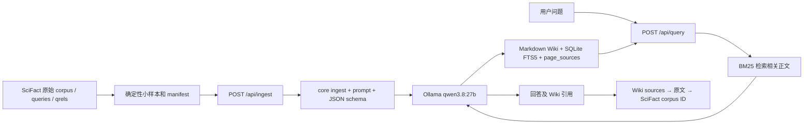

# KnowWeave 工程现状与架构

更新日期：2026-10-17（Asia/Shanghai）。本轮范围为 Round 01。
当前产品名与项目目录统一为 **KnowWeave**。`KNOWWAEVE_*` 环境变量及既有内部兼容名继续保留。

## 技术栈与入口

- Node.js 22、pnpm 10.12.1、TypeScript、Next.js 14 App Router、React 18。
- Markdown 保存原文、Wiki 页面、索引和日志；better-sqlite3 保存可重建的元数据和 FTS5 索引。
- `apps/web` 是 UI 和 API；`packages/core` 是 Wiki 操作；`packages/ingestion` 是输入解析；`packages/llm` 是模型传输和响应校验。
- Python 3 标准库只用于数据准备和验收脚本，无常驻 Python 服务。
- `scripts/local.mjs` 是本项目启动入口，绑定 127.0.0.1，默认隔离到仓库 `.local/wiki` 与 `.local/config`。

## 已审阅的真实调用链

导入：`apps/web/src/app/api/ingest/route.ts` → `ingestPastedText` / `ingestSource`
（`packages/core/src/ingest.ts`）→ `buildIngestPrompt` → `callLLM` →
Zod `IngestResponseSchema` → `applyIngestResponse`。
写入 `raw/`、`wiki/*.md`、`index.md`、`log.md`；更新 `pages`、`pages_fts`、
`sources`、`page_sources`，来源 UUID 同时存入 Markdown frontmatter。

问答：`apps/web/src/app/api/query/route.ts` → `queryWiki`
（`packages/core/src/query.ts`）→ `searchPages` → `readPage` → `buildQueryPrompt` →
`callLLM` → `QueryResponseSchema` → 校验回答引用必须来自实际提供的正文。
API 返回 `pagesUsed`，UI 中 `[[slug]]` 可跳到 Wiki 页面，页面来源链接跳到原始文档。
原始内容 API 是 `/api/sources/[id]`，页面 API 是 `/api/pages/[slug]`。

模型：API 根据 `defaultModels` 的操作槽选择 provider/model；本轮默认全部为
`ollama` / `qwen3.8:27b`。`packages/llm/src/client.ts` 继续提供共享 OpenAI SDK 接口，
`ollama.ts` 将本地请求转换为 `/api/chat`，以支持每请求 `num_ctx=32768`、
`num_predict=4096`、`think=false`、`temperature=0`。保留真实模型 tag，无额外模型下载。
文本输入按UTF-8字节上界加输出预算检查，超过上下文时拒绝，避免静默截断证据。
JSON 仍经过已有解析、Zod 校验与重试逻辑；无付费 API 强制依赖。
OpenRouter 为继承的可选入口，必须显式设置对应 provider 与 Key 才使用。

## 检索入口及 Round 02 接入点

- `packages/core/src/db.ts`：创建 `pages_fts`。
- `packages/core/src/db-pages.ts::indexPageForSearch`：页面内容索引；`searchPages` 使用 MATCH 和默认 BM25 `rank`。
- 本轮将全文问题的 AND 改成转义后的词项 OR，最多 64 个词，修复自然语言问题的空上下文问题；未引入向量检索。
- `query.ts` 的 `loadRelevantPages`、`ingest.ts` 的同名函数，以及 `chat.ts` 中的检索调用是后续统一检索接口的候选接入点。
- 更新/删除索引需覆盖 `ingest.ts`、`editor.ts`、`sync.ts` 的页面生命周期；后续向量索引必须同时覆盖这些入口。
- Wiki 页面检索与 SciFact 原始 corpus 检索是两个集合。Round 02 基准须从原始 corpus/queries/qrels 独立建索引，保持三种方法的集合与参数一致。

## 本轮边界与已知限制

本轮不实现 Embedding、Hybrid、RRF 或全量评测，不新增 MCP、GraphRAG、登录、云部署和数据库服务。
引用检查验证页面存在于模型上下文，不证明模型对文献的理解或科学结论正确，仍需阅读原文。
英文 SciFact 可用 FTS5 原始 tokenizer；中文分词、多语种检索尚未专项优化。
Qwen 的图片能力不等于接受 OpenRouter PDF 文件协议；本轮仅验证文本，小样本脚本不涉及 PDF/OCR。
模型导入不是事务性编译：网络失败会保留待重试的原始来源；重复演示会再新增来源。
项目通过仓库中的 `scripts/local.mjs` 启动；旧版 CLI/发布脚本已移出当前源码树。

代码来源、继承能力和独立改造范围见 [NOTICE](../NOTICE.md)；本项目不宣称全部功能从零原创。
当前源码审阅顺序与验收代码映射见 [GPT 审阅指南](GPT_REVIEW_GUIDE.md)。历史报告只描述指定提交和当时机器上的实测，不替代对当前 checkout 的独立验证。
